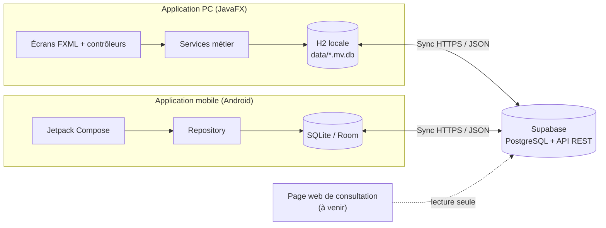

# Document technique

> Ce document décrit **comment** l'application est conçue et réalisée : architecture, base de données, API, technologies, tests et déploiement. Les besoins et objectifs sont décrits dans le [Cahier des charges](https://github.com/PPS-SAE-S5/PPS-COMP-2027/blob/main/Documentation/Sprint%202/CahierDesCharges(FR)v2.md).
>
> **Version 2 (fin du Sprint 2)** : cette version décrit l'application **telle qu'elle est réellement réalisée** dans le dépôt (application PC JavaFX et application mobile Android, avec synchronisation Supabase). Elle remplace les choix prévisionnels du Sprint 0 / Sprint 1 (voir [section 7](#7-évolutions-par-rapport-à-la-v1)).

## Table des matières

1. [Architecture](#1-architecture)
   - 1.1 [Vue d'ensemble](#11-vue-densemble)
   - 1.2 [Organisation du code](#12-organisation-du-code)
   - 1.3 [Fonctionnement hors-ligne et synchronisation](#13-fonctionnement-hors-ligne-et-synchronisation)
2. [Conception de la base de données](#2-conception-de-la-base-de-données)
   - 2.1 [Base locale (PC et mobile)](#21-base-locale-pc-et-mobile)
   - 2.2 [Base en ligne (Supabase / PostgreSQL)](#22-base-en-ligne-supabase--postgresql)
   - 2.3 [Colonnes de synchronisation](#23-colonnes-de-synchronisation)
3. [Logique métier](#3-logique-métier)
   - 3.1 [Calcul des points](#31-calcul-des-points)
   - 3.2 [Classements](#32-classements)
   - 3.3 [Planning (journées, ateliers, épreuves)](#33-planning-journées-ateliers-épreuves)
   - 3.4 [Rôles et droits d'accès](#34-rôles-et-droits-daccès)
4. [API](#4-api)
5. [Sécurité](#5-sécurité)
6. [Technologies](#6-technologies)
   - 6.1 [Application PC](#61-application-pc)
   - 6.2 [Application mobile](#62-application-mobile)
   - 6.3 [Base de données et backend](#63-base-de-données-et-backend)
7. [Évolutions par rapport à la v1](#7-évolutions-par-rapport-à-la-v1)
8. [Tests](#8-tests)
   - 8.1 [Stratégie de test](#81-stratégie-de-test)
   - 8.2 [Tests](#82-tests)
9. [Déploiement](#9-déploiement)
10. [Limites connues et suite](#10-limites-connues-et-suite)

---

## 1. Architecture

### 1.1 Vue d'ensemble

L'application suit une approche **« local d'abord » (offline-first)** : chaque appareil (ordinateur ou téléphone) possède sa **propre base de données locale** et fonctionne entièrement sans internet. Une base **Supabase** (PostgreSQL) partagée sert de point de rencontre : quand une connexion est disponible, les appareils s'y synchronisent.



| Composant | État | Description |
|---|---|---|
| Application PC | Réalisée | Application de bureau JavaFX, base locale H2 |
| Application mobile | Réalisée | Application Android (Kotlin, Jetpack Compose), base locale SQLite (Room) |
| Base en ligne | Réalisée | Supabase (PostgreSQL) partagée, accessible par l'API REST |
| Page web | À venir | Consultation des classements en lecture seule, sans compte (US 08, Sprint 3) |

Il n'y a **pas de serveur applicatif intermédiaire** : les applications parlent directement à l'API REST fournie par Supabase.

---

### 1.2 Organisation du code

```
PPS-COMP-2027/
├── Documentation/            
├── Base de données/          
├── Version PC/parapente-pps/ 
└── Version Mobile/parapente-pps-android/  
```

**Application PC** : architecture en couches, `com.pps.parapente.*`

| Package | Rôle |
|---|---|
| `model` | Classes métier : `Pilote`, `Epreuve`, `Resultat`, `Journee`, `Atelier`, `Utilisateur`, `Role`, `ModeCalcul`... |
| `dao` | Accès à la base H2 (SQL brut, JDBC) |
| `service` | Logique métier : `CalculService`, `ClassementService`, `PlanningService`, `AuthService`... |
| `controller` | Contrôleurs JavaFX, un par écran |
| `sync` | Synchronisation avec Supabase : `SyncService`, `SupabaseClient`, `SyncConfig`, `RapportSync` |
| `util` | Navigation, session, hachage de mot de passe, messages d'erreur |

**Application mobile** : `com.pps.parapente.*`

| Package | Rôle |
|---|---|
| `data` | Room (entités, DAO, base), `Repository` (logique métier : calcul, classements), sécurité |
| `sync` | Synchronisation avec Supabase (mêmes classes que la version PC) |
| `ui` | Jetpack Compose : thème, navigation, un fichier par écran dans `screens/` |

Les deux applications sont **alignées fonctionnellement** et utilisent la **même base Supabase**.

### 1.3 Fonctionnement hors-ligne et synchronisation

- Toutes les données sont **d'abord écrites en local** : l'application reste utilisable sans réseau (usage sur le terrain).
- Un écran **« Synchronisation en ligne »** (accessible à l'Administrateur et au Responsable d'épreuve) permet d'échanger les données avec Supabase.
- Chaque ligne synchronisée porte un **identifiant stable (`uuid`)** et une **date de modification (`updated_at`)** (voir [2.3](#23-colonnes-de-synchronisation)).
- **Règle de conflit** : si la même donnée a été modifiée sur deux appareils, la **modification la plus récente est conservée**.
- **Règles de rapprochement** (pour éviter les doublons) : pilotes par numéro de licence, comptes par identifiant, inscriptions et résultats par couple pilote + épreuve.

Trois sens de synchronisation sont disponibles (version PC 0.6) :

| Mode | Effet |
|---|---|
| **Fusionner** | Échange dans les deux sens, **ne supprime jamais rien** |
| **Base en ligne → application** (« pull ») | L'application devient identique à la base en ligne (supprime en local ce qui n'existe plus en ligne) |
| **Application → base en ligne** (« push ») | La base en ligne devient identique à l'application (supprime en ligne ce qui n'existe plus en local) |

Garde-fous : confirmation avant suppression, refus d'écraser une base remplie par une base vide, le compte `admin` et le compte connecté ne sont jamais supprimés. La **synchronisation automatique au démarrage** (optionnelle) est en **réception seule** : elle récupère les nouveautés sans rien envoyer ni supprimer.

---

## 2. Conception de la base de données

### 2.1 Base locale (PC et mobile)

La base locale (H2 sur PC, SQLite/Room sur mobile) est créée automatiquement au premier lancement. Schéma de référence : `Version PC/parapente-pps/src/main/resources/db/schema.sql`.

| Table | Contenu | Remarques |
|---|---|---|
| `utilisateurs` | Comptes de connexion (identifiant, mot de passe haché, rôle, actif) | Lien optionnel vers un pilote |
| `pilotes` | Fiche pilote : n° de licence (unique), nom, prénom, caserne, poids, email, année de naissance, genre | Le « genre » (Homme / Femme) remplace l'ancienne « catégorie » |
| `epreuves` | Épreuve entièrement paramétrable : mode de calcul, formule, valeur clé, sens du classement, affichage du classement, comptée au général | Voir [3.1](#31-calcul-des-points) |
| `epreuve_parametres` | Variables à saisir pour une épreuve (nom, libellé, unité, obligatoire) | Créées librement par le responsable |
| `bareme_points` | Table rang → points | Utilisée en mode `BAREME` |
| `inscriptions_epreuve` | Quel pilote passe quelle épreuve | Unique par (pilote, épreuve) |
| `resultats` | Valeurs saisies (JSON), points calculés, disqualification, auteur de la saisie, date | Unique par (épreuve, pilote) |
| `journees` | Journée de compétition (nom, date, ordre) | Sprint 2 |
| `ateliers` | Atelier d'une journée (créneau matin / après-midi, horaires, lieu, responsable) | Sprint 2 |
| `atelier_epreuves` | Épreuves d'un atelier, avec ordre de passage | Une épreuve n'appartient qu'à **un seul** atelier |

Un compte administrateur par défaut est créé au premier lancement (voir [section 5](#5-sécurité)).

Sur mobile, la base Room est en **version 2** (ajout du genre et des champs de synchronisation) avec `fallbackToDestructiveMigration` : une mise à jour de schéma **recrée la base locale** (acceptable en phase de test, à remplacer par de vraies migrations avant la mise en production).

---

### 2.2 Base en ligne (Supabase / PostgreSQL)

La base en ligne reprend les mêmes tables que la base locale (script `Base de données/schema.sql`, adapté de H2 vers PostgreSQL : `GENERATED BY DEFAULT AS IDENTITY`, `TIMESTAMPTZ`, `DOUBLE PRECISION`...). La **sécurité au niveau des lignes (RLS)** est activée sur toutes les tables.

---

### 2.3 Colonnes de synchronisation

Pour permettre la correspondance entre appareils, les tables synchronisées ont reçu :

| Colonne | Rôle |
|---|---|
| `uuid` | Identifiant stable partagé entre tous les appareils (l'`id` local recommence à 1 sur chaque appareil) |
| `updated_at` | Date de dernière modification, pour savoir quelle version est la plus récente |
| `supabase_id` (pilotes et épreuves) | Identifiant numérique attribué par Supabase, nécessaire pour renseigner les clés étrangères lors de l'envoi |

</br>

> **À aligner** : le fichier `Base de données/schema.sql` du dépôt ne contient pas encore ces colonnes, ni les tables `journees`, `ateliers` et `atelier_epreuves`. Elles sont ajoutées sur Supabase par des scripts de migration (`supabase_migration*.sql`, cités dans le README de la version PC) qui ne sont pas versionnés dans le dépôt. De même, `Base de données/BaseDeDonnées.md` décrit un **ancien modèle** (tables `participants`, `competitions`, `manches`, `classement`...) qui ne correspond plus à la base réellement utilisée : il doit être mis à jour ou supprimé.

---

## 3. Logique métier

### 3.1 Calcul des points

Les épreuves sont **100 % paramétrables** : le responsable crée ses variables à saisir et choisit un mode de calcul.

| Mode | Principe |
|---|---|
| `FORMULE` | Expression mathématique libre évaluée avec **exp4j**, par exemple `100 - temps*2 + nbrBalises*10`. Les variables sont celles de l'épreuve, plus `age` et `poidsPilote` issus de la fiche du pilote |
| `BAREME` | Les pilotes sont classés sur une **valeur clé** (`ASC` : plus petit = meilleur, `DESC` : plus grand = meilleur), puis reçoivent les points du barème selon leur rang. Les points de tous les pilotes sont **recalculés** à chaque nouvelle saisie |

Règles du club appliquées :
- un pilote **disqualifié** (sécurité) obtient **0 point** et ne prend pas de rang ;
- un pilote inscrit à une épreuve **sans résultat** obtient **0 point**.

Chaque épreuve possède aussi les options **« afficher le classement »** (affichage des points ou seulement du rang, US 10) et **« compte dans le classement général »**.

### 3.2 Classements

- **Classement général** : une colonne par épreuve, recalculé à la demande.
- **Détail par épreuve**.
- **Filtre par genre** : classement **Mixte**, **Hommes** ou **Femmes** ; les rangs sont recalculés parmi les pilotes retenus. Un pilote sans genre renseigné n'apparaît que dans le classement mixte.

### 3.3 Planning (journées, ateliers, épreuves)

Structure hiérarchique : **journée → ateliers (matin / après-midi) → épreuves**. Une épreuve n'appartient qu'à un seul atelier ; l'ordre de passage dans l'atelier est conservé.

### 3.4 Rôles et droits d'accès

Les droits sont appliqués **côté application** en masquant les écrans non autorisés après connexion.

| Rôle | Écrans accessibles |
|---|---|
| `ADMINISTRATEUR` | Tout |
| `RESPONSABLE_EPREUVE` | Tout sauf la gestion des comptes |
| `BENEVOLE` | Pilotes, saisie des résultats, planning, classements (pas de gestion des comptes, des épreuves ni de synchronisation) |
| `PILOTE`, `COMITE_PILOTES` | Consultation (classements, planning) uniquement |

> À confirmer lors du prochain sprint : les rôles du code (5 rôles) correspondent au cahier des charges v2, mais les droits du **comité** (modification des points, historique des modifications, US 12 et US 13) ne sont pas encore distingués de ceux du rôle `PILOTE` dans l'écran d'accueil de la version PC.

---

## 4. API

- **Format d'échange** : JSON.
- **Pas d'API développée à la main** : l'API REST est **générée automatiquement par Supabase** (PostgREST) à partir du schéma PostgreSQL.
- Les applications appellent directement `https://<projet>.supabase.co/rest/v1/<table>` en HTTPS, avec la clé publique (`anon`) dans l'en-tête `apikey`. Le client est écrit à la main (`SupabaseClient`, client HTTP natif de Java sur PC, équivalent Kotlin sur mobile).

| Opération | Requête | Usage |
|---|---|---|
| Lecture | `GET /rest/v1/{table}?select=...` | Récupération des données, test de connexion |
| Insertion / mise à jour (upsert) | `POST /rest/v1/{table}?on_conflict={colonne}` avec `Prefer: resolution=merge-duplicates` | Envoi des données (conflit sur `numero_licence`, `uuid`, `identifiant`...) |
| Insertion simple | `POST /rest/v1/{table}` | Ajout de lignes |
| Suppression | `DELETE /rest/v1/{table}?{filtre}` (ex. `id=eq.12`) | Synchronisation « miroir » |

L'URL du projet et la clé sont saisies dans l'écran de synchronisation et enregistrées dans `data/sync.properties` (PC), **hors du code source**. Ce fichier ne doit **jamais** être publié.

---

## 5. Sécurité

Points actuellement en place :
- **Mots de passe hachés** en SHA-256 avant stockage et avant envoi à Supabase.
- **RLS activée** sur toutes les tables Supabase.
- Comptes **désactivables** sans perte d'historique ; identifiants uniques sans tenir compte des majuscules ; le compte `admin` ne peut être ni supprimé ni désactivé.
- La clé API n'est pas dans le dépôt (fichier de configuration local).

Limites connues, assumées pour un outil interne au club à ce stade :
- **Compte administrateur par défaut** (`admin` / `admin123`) : le mot de passe **doit être changé** avant tout usage réel.
- **SHA-256** : suffisant pour un usage local, insuffisant pour des données exposées. Une solution plus robuste (bcrypt / argon2, ou authentification Supabase Auth) est éventuellement à prévoir.
- Les **droits par rôle ne sont appliqués que côté application**, pas côté serveur. Pour une sécurité réelle : politiques RLS par rôle, ou petit serveur intermédiaire plutôt que d'exposer la clé directement.
- Politiques RLS actuelles à vérifier : la documentation de la base ne décrit qu'une lecture publique sur certaines tables.
- Exigences de **sécurité, RGPD / RGESN** (données personnelles des pilotes : poids, année de naissance, email) : à préciser avec le client.

---

## 6. Technologies

### 6.1 Application PC

| Élément | Choix |
|---|---|
| Langage | Java 17 |
| Interface | **JavaFX 21.0.2** (FXML + CSS) |
| Build | Maven (`javafx-maven-plugin`) |
| Base locale | **H2 2.2.224** (fichier dans `data/`) |
| Calcul de formules | **exp4j 0.4.8** |
| JSON | `org.json` 20240303 |

### 6.2 Application mobile

| Élément | Choix |
|---|---|
| Langage | Kotlin (JVM 17) |
| Interface | **Jetpack Compose** (Material 3, BOM 2024.06.00) |
| Build | Gradle (Kotlin DSL), Android 8.0 (API 26) minimum, cible API 34 |
| Base locale | **Room 2.6.1** (SQLite) avec KSP |
| Calcul de formules | **exp4j 0.4.8** (même bibliothèque que le PC) |
| Asynchrone | Kotlin Coroutines 1.8.1 |

### 6.3 Base de données et backend

- **Supabase** (backend-as-a-service) : base **PostgreSQL**, **API REST auto-générée**, RLS.
- Les fonctionnalités d'**authentification et de temps réel Supabase ne sont pas utilisées** à ce jour : l'authentification est gérée par l'application (table `utilisateurs`) et la mise à jour des données passe par la synchronisation.

---

## 7. Évolutions par rapport à la v1

| Sujet | Prévu en v1 | Réalisé (v2) |
|---|---|---|
| Frontend | React / Node.js, Tailwind CSS/ Java, JavaFX | **JavaFX** (PC) et **Kotlin / Jetpack Compose** (mobile) ; pas de Tailwind |
| Architecture | Frontend + Supabase | Applications **locales** + synchronisation Supabase (offline-first) |
| Base de données | PostgreSQL via Supabase uniquement | **H2** (PC) et **SQLite/Room** (mobile) en local + PostgreSQL en ligne |
| Authentification | Supabase Auth (envisagée) | Comptes gérés par l'application (SHA-256) |
| Temps réel | Supabase Realtime (envisagé) | Synchronisation à la demande ou au démarrage |
| Calcul des points | Non défini | Formule libre (exp4j) ou barème par rang |
| Déploiement du frontend | Vercel | Application installable (PC) et APK (mobile) : Vercel réservé à la future page web |

---

## 8. Tests

### 8.1 Stratégie de test

- Les applications étant écrites en **Java** (PC) et **Kotlin** (mobile), des tests **JUnit** sont prévus pour la logique métier (`CalculService`, `ClassementService`, synchronisation).
- Des **tests globaux** sont à réaliser sur les différents cas d'utilisation, sur toutes les plateformes, y compris en **mode hors-ligne puis resynchronisé**.
- L'objectif est de mettre la synchronisation sous contrainte (modifications concurrentes sur deux appareils, coupures réseau, base vide ou très remplie) et d'observer le comportement des données.

### 8.2 Tests

| Type de test | État |
|---|---|
| Tests unitaires JUnit (PC) | **À faire** : aucun test automatisé dans le dépôt à ce jour |
| Tests unitaires (mobile) | **À faire** |
| Tests de synchronisation (conflits, hors-ligne) | **À faire** |
| Tests manuels sur les cas d'utilisation (CU 01 à CU 10) | Réalisés au fil des sprints pour la recette client *(à formaliser dans le plan de tests)* |
| Fichier de test d'accès à Supabase | `Base de données/test-supabase.html` (test manuel de connexion) |

---

## 9. Déploiement

| Composant | Mode de livraison | Détail |
|---|---|---|
| Application PC | Lancement via Maven (`mvn clean javafx:run`) ou JAR (`mvn clean package`) | Java 17+ ; la base locale est le dossier `data/` à côté de l'application (à sauvegarder pour conserver les données) |
| Application mobile | Fichier **APK** installable | Généré depuis Android Studio (`Build > Build APK(s)`), Android 8.0 minimum |
| Base en ligne | **Supabase** (offre gratuite pour l'usage prévu) | Scripts SQL à exécuter une fois dans l'éditeur SQL de Supabase |
| Page web (à venir) | **Vercel** *(à confirmer)* | Consultation des classements en lecture seule |

Il n'y a pas encore de déploiement continu automatisé ; les releases (démo + installation) sont préparées à la fin de chaque sprint.

---

## 10. Limites connues et suite

À traiter dans les prochains sprints :

- **Page web** de consultation des classements sans compte (US 08) et page du classement en lecture seule (Sprint 3).
- **Historique des modifications de points** (logs d'ajout / retrait, US 13).
- **Rafraîchissement automatique du classement** : à ce jour le classement est recalculé à la demande ; le rafraîchissement périodique et la mise à jour « quasi temps réel » reposent sur la synchronisation (à confirmer pour le mode d'actualisation final : sondage périodique ou Supabase Realtime).
- **Sécurité renforcée** : hachage avec sel, droits côté serveur (RLS par rôle), changement obligatoire du mot de passe par défaut.
- **Migrations de la base mobile** à la place de la recréation automatique.
- **Alignement de la documentation de la base** (`schema.sql` Supabase et `BaseDeDonnées.md`) avec le schéma réel.
- **Tests automatisés** et plan de tests.
- **Export des classements** (PDF / Excel) : piste d'évolution.
