# Documentation Utilisateur (fr) v2 - version PC

## Sommaire

- [1. Présentation générale](#1-présentation-générale)
- [2. Connexion et rôles](#2-connexion-et-rôles)
- [3. Tableau de bord](#3-tableau-de-bord)
- [4. Gestion des pilotes](#4-gestion-des-pilotes)
- [5. Gestion des épreuves](#5-gestion-des-épreuves)
- [6. Planning des journées](#6-planning-des-journées)
- [7. Saisie des résultats](#7-saisie-des-résultats)
- [8. Classements](#8-classements)
- [9. Suivi des participants](#9-suivi-des-participants)
- [10. Gestion des comptes](#10-gestion-des-comptes-administrateur)
- [11. Synchronisation en ligne](#11-synchronisation-en-ligne)
- [12. Stockage des données et sauvegarde](#12-stockage-des-données-et-sauvegarde)
- [13. Questions fréquentes](#13-questions-fréquentes)

---

## 1. Présentation générale

L'application remplace les feuilles papier et fichiers Excel utilisés jusqu'ici pour
organiser le championnat. Elle permet :

- d'inscrire les pilotes,
- de créer librement les épreuves du championnat (la liste n'est jamais figée : c'est
  le club qui décide du nombre d'épreuves, de leur nom, et de la façon dont les points
  sont calculés),
- d'organiser la compétition en **journées**, **ateliers** et **épreuves**,
- de saisir les résultats au fur et à mesure des épreuves,
- de consulter un **classement provisoire** (général ou par épreuve), mixte ou séparé
  hommes / femmes,
- de suivre le détail des scores de chaque participant,
- de **synchroniser** les données entre plusieurs ordinateurs et téléphones dès qu'internet est disponible.

L'application fonctionne **sans internet** : les données sont d'abord enregistrées sur
l'ordinateur, puis partagées en ligne quand une connexion est disponible
(voir [section 11](#11-synchronisation-en-ligne)).

</br>

> Une version **mobile (Android)** existe également, avec la plupart de ces fonctionnalités.
> Voir la documentation utilisateur de la version mobile.

---

## 2. Connexion et rôles

Au démarrage, l'application affiche un écran de connexion : saisissez votre
**identifiant** et votre **mot de passe**, puis cliquez sur **Se connecter**.

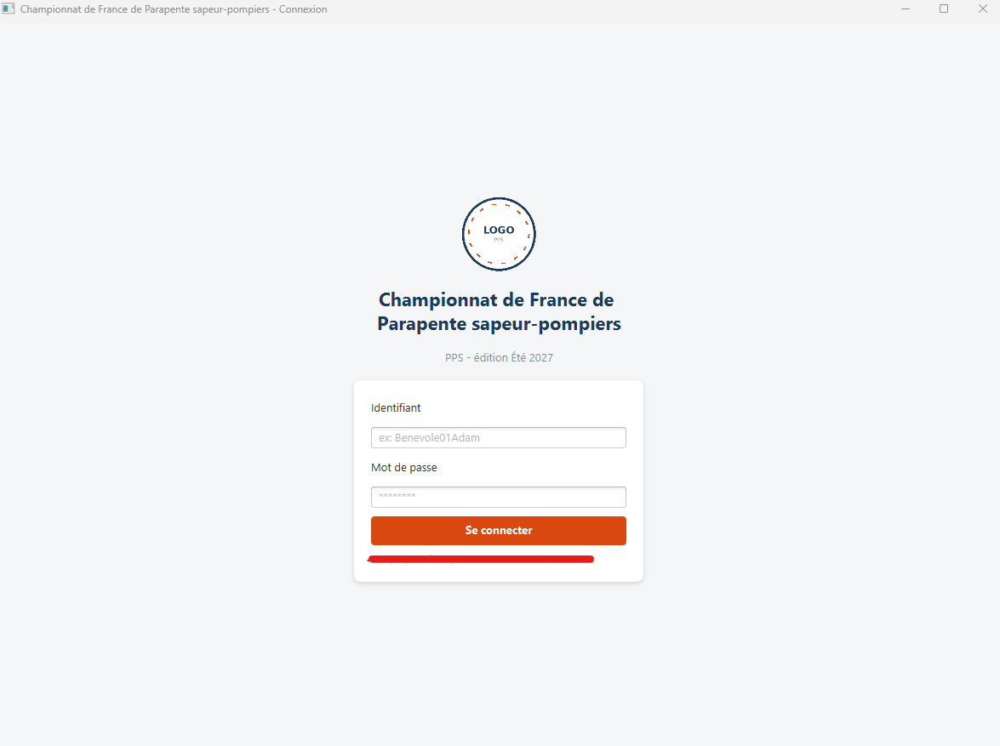

Chaque compte a un **rôle**, qui détermine ce qu'il peut faire dans l'application :

| Rôle | Peut faire |
|---|---|
| **Administrateur** | Tout, y compris créer les comptes des autres utilisateurs |
| **Responsable de l'épreuve** | Créer/modifier les épreuves, organiser le planning, gérer les pilotes, saisir des résultats, consulter les classements, synchroniser |
| **Bénévole** | Gérer les pilotes, saisir des résultats, suivre les participants, consulter les classements et le planning |
| **Pilote** | Consulter les classements et le planning (lecture seule) |
| **Comité des pilotes** | Consulter les classements et le planning (lecture seule) |

Un compte administrateur existe par défaut à la première installation.
**Pensez à créer vos propres comptes puis à changer le mot de passe du compte par défaut**
(voir [section 10](#10-gestion-des-comptes-administrateur)).

---

## 3. Tableau de bord

Après connexion, le tableau de bord affiche uniquement les fonctionnalités auxquelles
votre rôle donne accès, sous forme de cartes cliquables, rangées en trois sections :

| Section | Cartes |
|---|---|
| **Préparer la compétition** | Gestion des épreuves, Planning des journées, Gestion des pilotes |
| **Pendant la compétition** | Saisie des résultats, Classement général, Suivi des participants |
| **Administration** | Gestion des comptes, Synchronisation en ligne |

Votre identifiant et votre rôle s'affichent en haut de l'écran, avec le bouton **Déconnexion**.

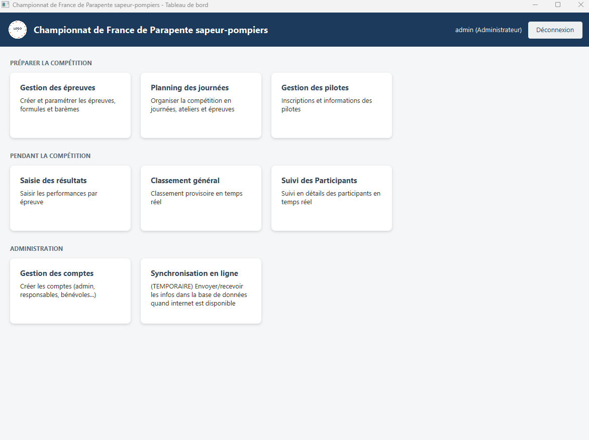

---

## 4. Gestion des pilotes

Cet écran sert à inscrire les pilotes au championnat.

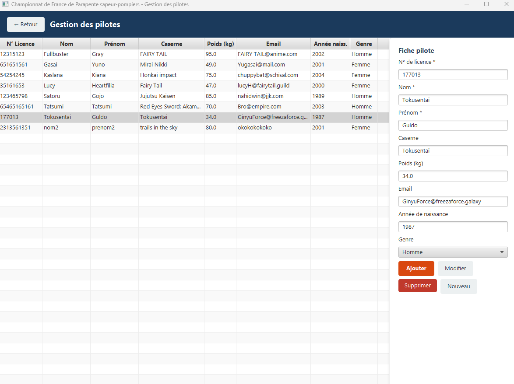

**Informations demandées à l'inscription :**

- Numéro de licence (obligatoire, unique, sert d'identifiant)
- Nom, prénom (obligatoires)
- Caserne
- Poids (kg)
- Email
- Année de naissance
- Genre (Homme ou Femme)

**Utilisation :**

1. Remplissez le formulaire à droite, cliquez sur **Ajouter**.
2. Pour modifier un pilote : cliquez sur sa ligne dans le tableau (le formulaire se remplit automatiquement), modifiez les champs, cliquez sur **Modifier**.
3. Pour supprimer un pilote : sélectionnez-le puis cliquez sur **Supprimer** (cela supprime aussi tous ses résultats déjà saisis).
4. Cliquez sur **Nouveau** pour vider le formulaire.

</br>

> Dès qu'un pilote est ajouté, il est automatiquement inscrit à toutes les épreuves déjà actives. Il devra donc les passer : s'il ne se présente pas à une épreuve, il aura automatiquement 0 point à celle-ci dans le classement général.

> Le **genre** sert aux classements séparés hommes / femmes ([section 8](#8-classements)).
> Un pilote dont le genre n'est pas renseigné n'apparaît que dans le classement mixte.

---

## 5. Gestion des épreuves

C'est le cœur de l'application : **aucune épreuve n'est prédéfinie**. Le club crée
librement chaque épreuve du championnat (atterrissage de précision, marche & vol,
cross, checkpoint... ou toute autre épreuve imaginée par le club), avec ses propres
règles de calcul des points.

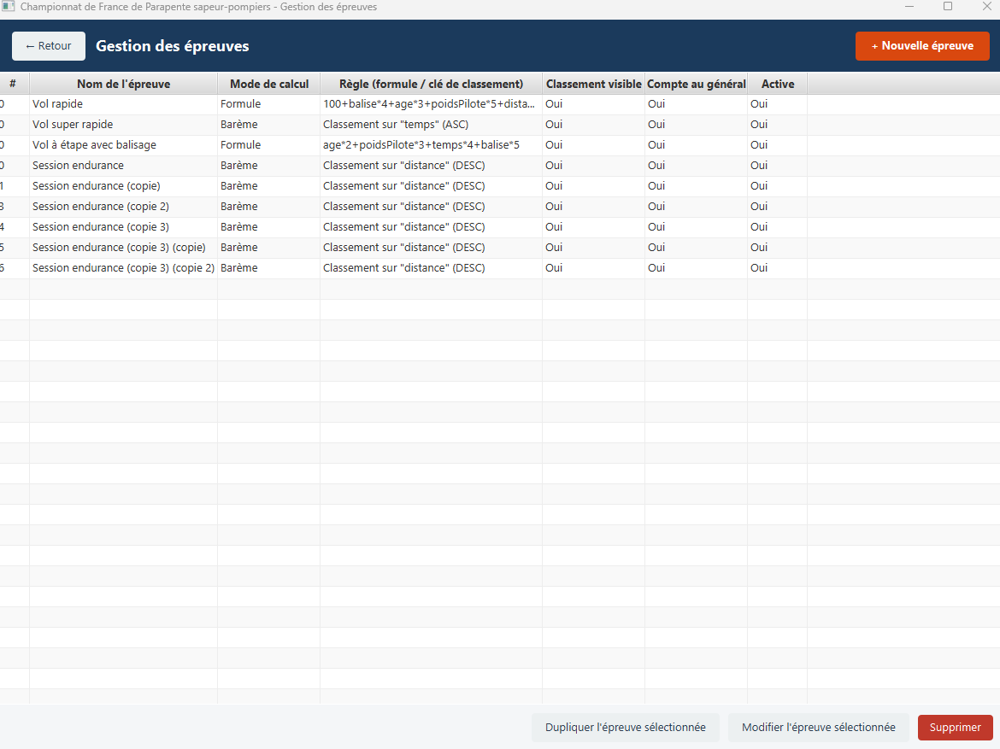

Le tableau liste les épreuves avec leur mode de calcul, leur règle, et trois indicateurs :
**Classement visible**, **Compte au général** et **Active**.

Sous le tableau :
- **+ Nouvelle épreuve** ouvre le formulaire de création
- **Modifier l'épreuve sélectionnée**
- **Dupliquer l'épreuve sélectionnée** : crée une copie pratique pour une épreuve proche d'une autre
- **Supprimer** (supprime aussi les résultats de l'épreuve)

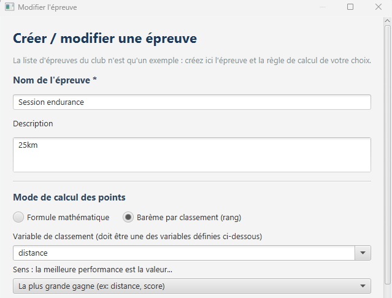
</br>
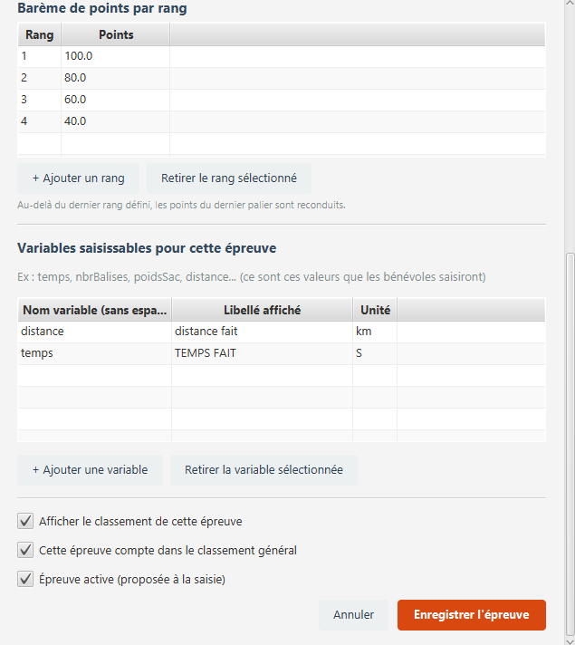

</br>

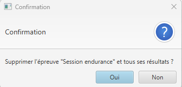

---

### 5.1 Informations générales

- **Nom** et **description** de l'épreuve.

---

### 5.2 Variables saisissables

Définissez librement les valeurs qui devront être mesurées/saisies pour cette épreuve
(ex : `temps`, `nbrBalises`, `poidsSac`, `distance`...). Chaque variable a :
- un **nom technique** (sans espace, utilisé ensuite dans le calcul),
- un **libellé** affiché lors de la saisie,
- une **unité** (facultative, pour l'affichage).

Utilisez **+ Ajouter une variable** et **Retirer la variable sélectionnée**.

---

### 5.3 Mode de calcul des points

Deux modes possibles, au choix :

**a) Formule mathématique**

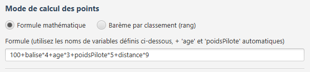

Vous écrivez directement une formule utilisant les variables définies ci-dessus, par exemple :

```
100 - temps*2 + nbrBalises*10 - poidsSac*0.5
```

Deux variables sont automatiquement disponibles en plus, sans avoir besoin de les
saisir : `age` et `poidsPilote` (venant de la fiche du pilote).

**b) Barème par classement**

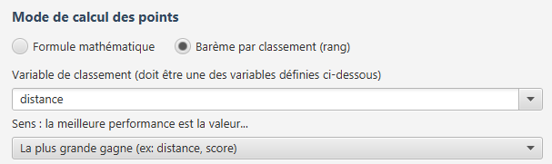

Les pilotes sont classés selon une variable clé de votre choix (ex : `temps` ou
`distance`), dans le sens que vous précisez (la plus petite valeur gagne, ou la plus
grande), puis les points sont attribués selon un tableau « rang → points » que vous
définissez (ex : 1er = 100 pts, 2e = 90 pts, 3e = 80 pts...). Au-delà du dernier rang
défini, les points du dernier palier sont automatiquement reconduits pour tout le monde.

>  Le barème se recalcule automatiquement pour **tous** les pilotes de l'épreuve à chaque nouvelle saisie, puisque les rangs sont relatifs les uns aux autres.

### 5.4 Options de l'épreuve

- **Afficher le classement** : rend le détail de cette épreuve consultable et affiche sa colonne dans le classement général. Si elle est décochée, seul le rang / total est montré, sans le détail de l'épreuve.
- **Compte dans le classement général** : les points de cette épreuve sont additionnés
  au total du championnat.
- **Active** : l'épreuve apparaît (ou non) dans l'écran de saisie des résultats.

Terminez avec **Enregistrer l'épreuve**.

---

## 6. Planning des journées

Cet écran permet d'organiser la compétition dans le temps. La structure est la suivante :

**Journée → Ateliers (matin / après-midi) → Épreuves**

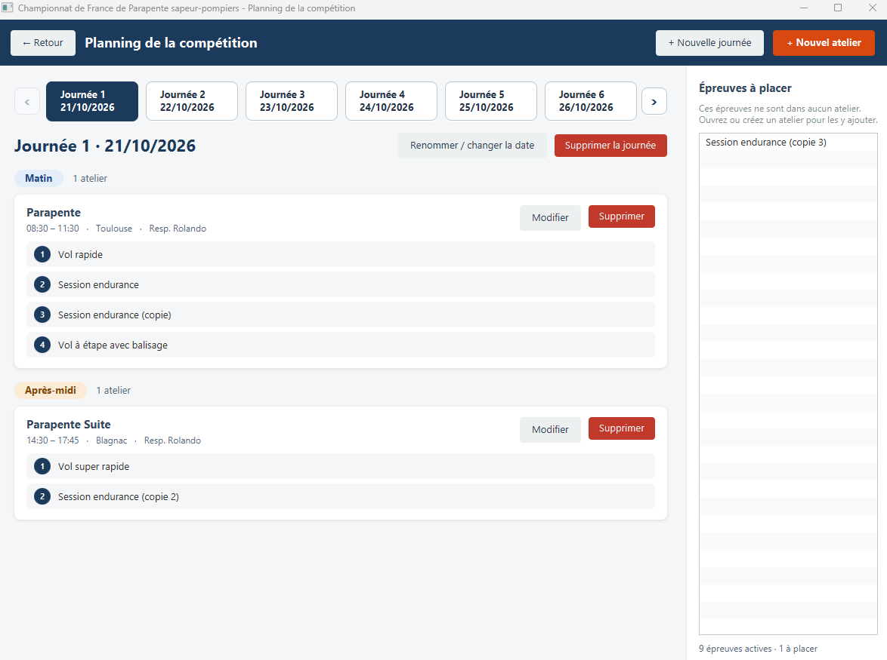

- **+ Nouvelle journée** : crée une journée (nom et date). Les flèches `‹` et `›` permettent de passer d'une journée à l'autre. **Renommer / changer la date** et **Supprimer la journée** modifient la journée affichée.
- **+ Nouvel atelier** : ouvre le formulaire d'un atelier.
- La zone **Épreuves à placer** liste les épreuves qui ne sont dans aucun atelier.

### Créer un atelier

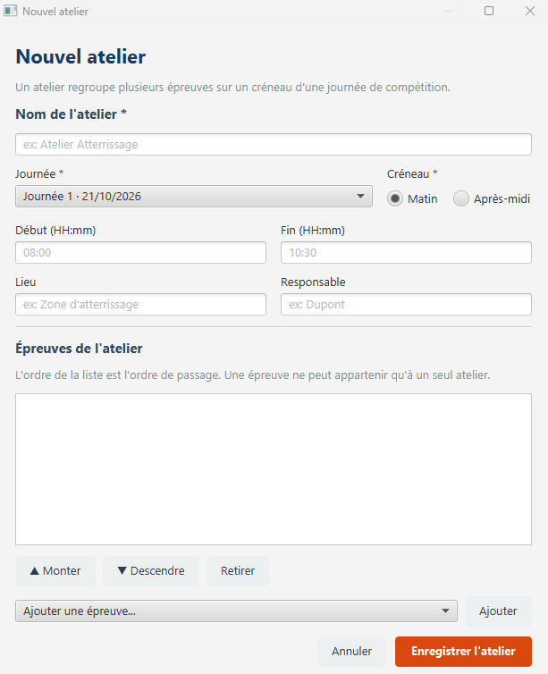

Un atelier regroupe plusieurs épreuves sur un créneau d'une journée de compétition. Renseignez :

- le **nom** de l'atelier et la **journée** (obligatoires)
- le **créneau** : Matin ou Après-midi (obligatoire)
- les **horaires** de début et de fin (format `HH:mm`, facultatifs)
- le **lieu** et le **responsable** (facultatifs)
- les **épreuves de l'atelier** : choisissez-les avec **Ajouter une épreuve...**. L'ordre de la liste est l'ordre de passage , utilisez **▲ Monter** / **▼ Descendre** pour le changer, et **Retirer** pour l'enlever

> Une épreuve ne peut appartenir qu'à **un seul** atelier.

**Droits :** seuls l'Administrateur et le Responsable de l'épreuve peuvent modifier le
planning. Les autres rôles le consultent en lecture seule.

---

## 7. Saisie des résultats


1. Choisissez l'**épreuve** concernée dans la liste déroulante.
2. Choisissez le **pilote** (seuls les pilotes inscrits à cette épreuve apparaissent).
3. Le formulaire de saisie s'adapte **automatiquement** : il affiche un champ pour chaque variable définie pour cette épreuve (voir [section 5.2](#52-variables-saisissables)).
4. Renseignez les valeurs mesurées. Appuyer sur **Entrée** passe au champ suivant, le dernier champ valide la saisie.
5. Si le pilote doit être disqualifié (problème de sécurité, etc.), cochez la case correspondante : il obtient automatiquement 0 point.
6. Cliquez sur **Enregistrer le résultat**.

Le tableau à droite liste tous les résultats déjà saisis pour l'épreuve sélectionnée,
avec les points calculés en direct.

---

## 8. Classements

L'écran **Classements** propose deux onglets et un bouton **Actualiser** pour recalculer
après de nouvelles saisies.

### 8.1 Classement général


Affiche, pour chaque pilote : son rang, son genre, ses points sur chaque épreuve comptant dans le
classement général, et son total.

La liste déroulante **Classement** permet de choisir :
- **Mixte** : hommes et femmes ensemble
- **Hommes** : seulement les hommes
- **Femmes** : seulement les femmes

Les rangs sont recalculés parmi les pilotes retenus (la 1re femme du classement « Femmes »
a le rang 1). Ce choix s'applique aussi au détail par épreuve.

> Un pilote inscrit à une épreuve mais sans résultat saisi obtient automatiquement 0 point à cette épreuve (règle du club : toute personne inscrite doit passer les épreuves).

> Si la case « Afficher le classement » d'une épreuve est décochée, son détail est masqué, mais ses points comptent toujours dans le total si « Compte dans le classement général » est coché.

### 8.2 Détail par épreuve


Cet onglet permet de consulter le classement complet d'**une seule épreuve**, avec le
détail des valeurs saisies pour chaque pilote. Seules les épreuves dont l'option
**« Afficher le classement »** est cochée apparaissent dans la liste déroulante.

Cet écran est accessible à **tous les rôles**, y compris les Pilotes et le Comité des
pilotes.

---

## 9. Suivi des participants

Cet écran permet de voir en détail les scores d'un pilote.

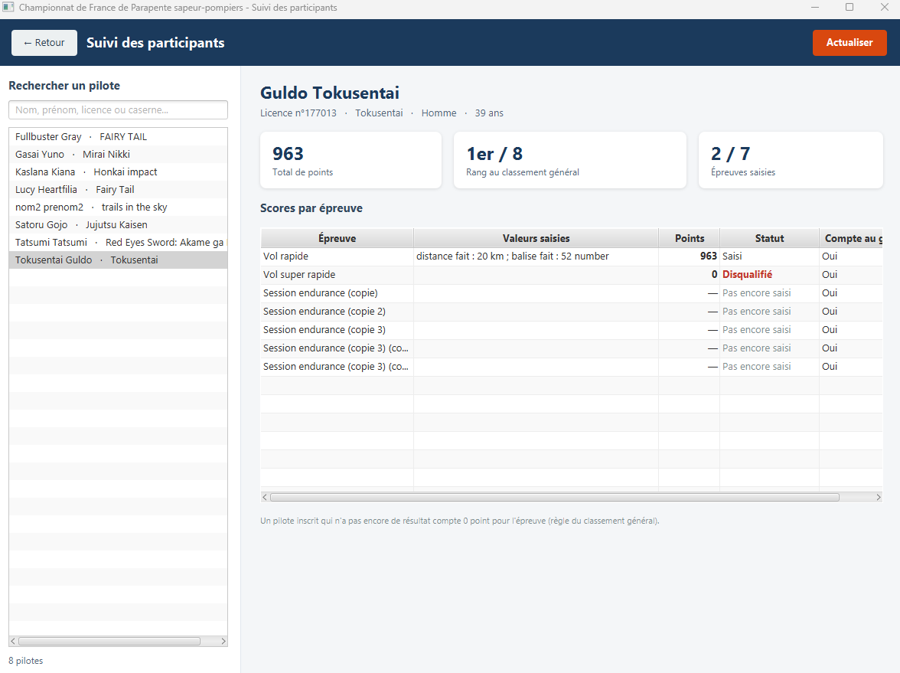

1. Cherchez un pilote avec la barre **Rechercher un pilote** (nom, prénom, licence ou caserne).
2. Cliquez sur son nom dans la liste de gauche.
3. L'écran affiche son **total de points**, son **rang au classement général** et le nombre d'**épreuves saisies**, puis le tableau **Scores par épreuve** (valeurs saisies, points, statut, et si l'épreuve compte au général).
4. Cliquez sur **Actualiser** pour recharger les données.

> Un pilote inscrit qui n'a pas encore de résultat compte 0 point pour l'épreuve.

Cet écran est accessible à l'Administrateur, au Responsable de l'épreuve et au Bénévole.

---

## 10. Gestion des comptes (Administrateur)


Réservé au rôle Administrateur. Permet de gérer les comptes de chaque personne
impliquée dans l'organisation (responsable d'épreuve, bénévoles...).

**Créer un compte :** saisissez l'**identifiant**, le **mot de passe** et le **rôle**
(champs obligatoires), puis cliquez sur **Créer le compte**. Les identifiants sont uniques,
sans tenir compte des majuscules.

**Gérer un compte existant :** sélectionnez-le dans le tableau, puis :
- **Activer / Désactiver le compte** : un compte désactivé ne peut plus se connecter, sans perdre son historique
- **Changer le mot de passe** : saisissez le nouveau mot de passe puis validez
- **Supprimer le compte sélectionné** (une confirmation est demandée)

> Le compte `admin` par défaut ne peut ni être supprimé, ni désactivé. Vous ne pouvez pas
> non plus supprimer ou désactiver le compte avec lequel vous êtes connecté.
> **Changez son mot de passe dès la première utilisation.**

---

## 11. Synchronisation en ligne

L'application fonctionne entièrement en local. Quand l'ordinateur retrouve internet, cet écran
permet d'envoyer ou de recevoir les données avec la base en ligne (Supabase), partagée entre
tous les appareils du championnat (ordinateurs et téléphones).

Cet écran est réservé à l'Administrateur et au Responsable de l'épreuve.

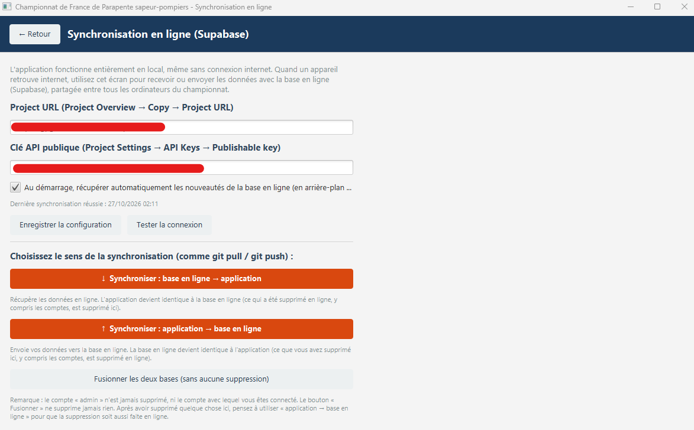

### 11.1 Première configuration

1. Collez l'**URL du projet** et la **clé API publique** (fournies par la personne en charge technique).
2. Cliquez sur **Enregistrer la configuration**, puis sur **Tester la connexion**.
3. (Facultatif) Cochez la case de **synchronisation automatique au démarrage** : au lancement,
   l'application récupère discrètement les nouveautés en ligne. Elle ne fait que recevoir :
   rien n'est envoyé ni supprimé, et l'ouverture n'est jamais bloquée si vous êtes hors-ligne.

### 11.2 Choisir le sens de la synchronisation

| Bouton | Effet |
|---|---|
| **↓ Base en ligne → application** | L'application devient **identique** à la base en ligne. Ce qui a été supprimé en ligne (y compris des comptes) est supprimé sur l'ordinateur |
| **↑ Application → base en ligne** | La base en ligne devient **identique** à l'application. Ce que vous avez supprimé ici est supprimé en ligne |
| **Fusionner les deux bases** | Échange dans les deux sens, **sans jamais rien supprimer** |

Un résumé indique ensuite combien de lignes ont été reçues, envoyées ou supprimées.

> Les deux boutons « sens unique » **suppriment** des données et demandent une confirmation.
> Le compte `admin` et le compte connecté ne sont jamais supprimés. Une base vide ne peut pas écraser une base remplie.

> **Pour supprimer quelque chose partout** : supprimez-le sur un appareil, puis utilisez « Application → base en ligne » sur les autres appareils, utilisez « Base en ligne → application ».

> Si la même donnée a été modifiée sur deux appareils, c'est la modification la plus récente qui est conservée. Les pilotes sont rapprochés par numéro de licence, les comptes par identifiant, les inscriptions et résultats par couple pilote + épreuve : pas de doublons.

---

## 12. Stockage des données et sauvegarde

Toutes les données (pilotes, épreuves, planning, résultats, comptes) sont stockées **localement**,
dans un dossier `data/` situé à côté de l'application. Aucune connexion internet n'est
nécessaire pour utiliser l'application au quotidien. La synchronisation
([section 11](#11-synchronisation-en-ligne)) permet en plus de partager les données avec la base en ligne.

**Pensez à sauvegarder régulièrement ce dossier `data/`** (copie sur clé USB, disque
externe...), notamment avant et pendant l'événement, afin de ne jamais perdre les
résultats du championnat.

> Le dossier `data/` contient aussi la configuration de synchronisation (fichier `sync.properties`) :
> **ne le partagez pas publiquement**.

---

## 13. Questions fréquentes

**J'ai créé une épreuve mais un pilote n'apparaît pas dans la liste au moment de la
saisie des résultats.**
Vérifiez qu'il a bien été inscrit après la création de l'épreuve (l'inscription se fait
normalement automatiquement) et que l'épreuve est bien marquée comme « Active ».

**Le classement d'une épreuve n'apparaît pas dans l'onglet « Détail par épreuve ».**
Vérifiez que l'option **« Afficher le classement »** est bien cochée pour cette épreuve.

**Un pilote n'apparaît pas dans le classement « Hommes » ou « Femmes ».**
Vérifiez que son **genre** est renseigné sur sa fiche. Sans genre, il n'apparaît que dans le classement Mixte.

**Une épreuve n'apparaît pas dans le planning.**
Elle est probablement dans la zone **Épreuves à placer** : ouvrez ou créez un atelier pour l'y ajouter.
Seules les épreuves actives sont proposées.

**J'ai modifié le nom d'une épreuve, dois-je ressaisir les résultats ?**
Non, les résultats sont conservés, seul le nom affiché change.

**Une donnée que j'ai supprimée réapparaît après une synchronisation.**
Utilisez le bouton « Fusionner » ou la synchronisation automatique au démarrage : ils ne suppriment jamais rien,
donc la donnée est restée en ligne ou sur un autre appareil. Voir [section 11.2](#112-choisir-le-sens-de-la-synchronisation).

**La synchronisation affiche une erreur.**
Vérifiez la connexion internet, l'URL du projet et la clé API, puis cliquez sur **Tester la connexion**.
Le message indique la cause (pas de connexion, URL invalide, délai dépassé, erreur renvoyée par la base en ligne).

**Un message d'erreur apparaît, que faire ?**
Les messages affichés sont volontairement rédigés en français simple. S'ils persistent,
contactez la personne en charge technique de l'application.
