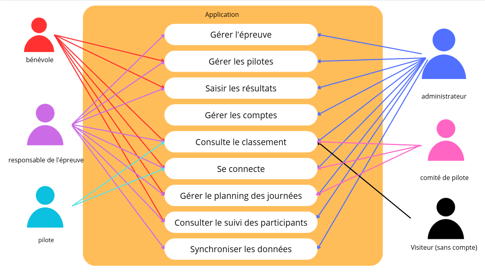

# Cahier des charges fonctionnel (v3)

> Ce document décrit **ce que l'application doit faire** et **pourquoi**. Les choix techniques (architecture, technologies, base de données, tests, déploiement) sont détaillés dans le [Document technique v3](https://github.com/PPS-SAE-S5/PPS-COMP-2027/blob/main/Documentation/Sprint%203/Documentation%20Technique(v3)(fr).md).

## Table des matières

1. [Aperçu du projet](#1-aperçu-du-projet)
   - 1.1 [Contexte du projet](#11-contexte-du-projet)
   - 1.2 [Objectifs](#12-objectifs)
2. [Exigences](#2-exigences)
   - 2.1 [Exigences fonctionnelles](#21-exigences-fonctionnelles)
   - 2.2 [Exigences non fonctionnelles](#22-exigences-non-fonctionnelles)
   - 2.3 [Utilisateurs et rôles](#23-utilisateurs-et-rôles)
3. [Cas d'utilisation](#3-cas-dutilisation)
   - 3.1 [Diagramme de cas d'utilisation](#31-diagramme-de-cas-dutilisation)
   - 3.2 [Description des cas d'utilisation](#32-description-des-cas-dutilisation)
4. [Périmètre et contraintes](#4-périmètre-et-contraintes)
   - 4.1 [Périmètre](#41-périmètre)
   - 4.2 [Contraintes](#42-contraintes)
5. [Livrables](#5-livrables)
6. [User stories et backlog](#6-user-stories-et-backlog)
   - 6.1 [User stories](#61-user-stories)
   - 6.2 [Backlogs](#62-backlogs)
   - 6.3 [Planification des sprints](#63-planification-des-sprints)
7. [Organisation du projet](#7-organisation-du-projet)
   - 7.1 [Parties prenantes](#71-parties-prenantes)
   - 7.2 [Fonctionnement et communication](#72-fonctionnement-et-communication)
   - 7.3 [Budget](#73-budget)
8. [Recette et validation](#8-recette-et-validation)
9. [Améliorations futures](#9-améliorations-futures)

---

## 1. Aperçu du projet

### 1.1 Contexte du projet

Le club Parapente Pays de Sault (PPS), situé dans l'Aude, organise à l'été 2027 le Championnat de France de Parapente des sapeurs-pompiers.

Jusqu'ici, l'organisation de la compétition repose sur des documents papier et des fichiers Excel. Les résultats sont collectés et traités à la main, en particulier pour établir les classements provisoires à la fin de chaque journée.

Le club veut remplacer ce fonctionnement par un outil numérique qui centralise les informations de la compétition : pilotes, épreuves, planning, résultats et classements.

### 1.2 Objectifs

Le projet consiste à concevoir et développer une application pour ordinateur, une application mobile (Android) et une page web dédiées à la gestion de la compétition.

Chaque utilisateur choisit l'application qui lui convient. Les deux applications enregistrent les données dans une base locale et fonctionnent donc sans internet, dès qu'une connexion est disponible, elles se synchronisent avec une base de données en ligne partagée.\
La page web lit cette base en ligne pour afficher le classement.

L'accès aux fonctionnalités dépend du rôle de l'utilisateur (voir [section 2.3](#23-utilisateurs-et-rôles)).

Le client attend un outil durable et évolutif.\
De nouvelles épreuves ou de nouvelles règles pourront apparaître : l'application ne doit pas se limiter à une liste figée de types d'épreuves. Les épreuves doivent être entièrement paramétrables, pour que le club puisse en créer de nouvelles sans modifier le code.

L'interface doit rester lisible et simple à utiliser, y compris pour des personnes peu habituées aux outils numériques.

---

## 2. Exigences

### 2.1 Exigences fonctionnelles

Les exigences sont précisées et validées avec le client au fil des sprints.\
À la fin du Sprint 3, elles sont les suivantes :

* **Gestion des épreuves** : création, modification, duplication et suppression d'épreuves, avec leurs variables à saisir et leur mode de calcul des points (formule ou barème par rang).
* **Gestion des pilotes** : inscription et modification des fiches pilotes. Chaque pilote appartient à une catégorie : **pompier** (participe au championnat) ou **open** (invité, classé mais hors championnat).\
La catégorie est déduite du numéro de pilote.
* **Saisie des résultats** : enregistrement des valeurs mesurées pour chaque pilote et chaque épreuve, avec la possibilité de disqualifier un pilote (0 point).
* **Calcul automatique des points et des classements** : classement général et classement par épreuve, filtrés par genre (général, hommes, femmes) et par catégorie (pompiers, open). Les classements sont mis à jour en quasi temps réel.
* **Planning des journées** : organisation des ateliers sur des journées découpées en créneaux du matin et de l'après-midi, avec export du planning d'une journée en PDF.
* **Suivi des participants** : fiche détaillée d'un pilote (total de points, rang, épreuves passées, score par épreuve), avec une recherche par nom, prénom, licence ou département.
* **Gestion des comptes** : création, désactivation et suppression des comptes, attribution des rôles.
* **Consultation du classement sans compte** : depuis l'écran de connexion des applications, et depuis une page web publique.
* **Historique des modifications de points** : traçabilité des ajouts et retraits de points en cas de litige.

Les fonctionnalités demandées pour les prochains sprints sont listées en [section 9](#9-améliorations-futures).

### 2.2 Exigences non fonctionnelles

**Multiplateforme**
- L'application doit être utilisable sur ordinateur (Windows et Mac) et sur smartphone Android.
- L'interface doit s'adapter à la taille de l'écran.

**Fonctionnement hors-ligne**
- La saisie et la consultation doivent fonctionner sans réseau, sur le terrain. Les données sont synchronisées au retour de la connexion.

**Ergonomie**
- L'application doit être utilisable par des personnes non informaticiennes, sans connaissance technique particulière.

**Autres exigences**
- Les exigences de sécurité, de performance, d'accessibilité et de protection des données personnelles (RGPD) restent à préciser avec le client.

### 2.3 Utilisateurs et rôles

| Rôle | Droits |
|---|---|
| **Administrateur** | Tous les droits, dont la gestion des comptes et des rôles. |
| **Responsable d'épreuve** | Gestion des épreuves, du planning et des pilotes, saisie des résultats, suivi des participants, classements, synchronisation. |
| **Bénévole** | Gestion des pilotes, saisie des résultats, suivi des participants, classements, consultation du planning. |
| **Comité des pilotes** | Consultation du planning et des classements. Modification des points et visualisation de l'historique. |
| **Visiteur** | Consultation des classements en lecture seule, sans identifiant : bouton "Non, je veux uniquement suivre le classement" des applications, ou page web. |

Dans les applications, l'accès visiteur passe par un compte invité interne de rôle "Pilote.\
Ce rôle ne sert qu'à consulter le classement.

---

## 3. Cas d'utilisation

### 3.1 Diagramme de cas d'utilisation

### 3.2 Description des cas d'utilisation

Les droits de chaque rôle sont décrits en [section 2.3](#23-utilisateurs-et-rôles). Le tableau ci-dessous décrit ce que chaque acteur fait dans l'application.

| N° | Cas d'utilisation | Acteurs | Préconditions | Scénario principal | Résultat | US |
|---|---|---|---|---|---|---|
| CU 01 | Se connecter | Utilisateur avec compte | Le compte existe et est actif | L'utilisateur saisit son identifiant et son mot de passe | Il accède aux fonctionnalités de son rôle | [US 14](https://github.com/PPS-SAE-S5/PPS-COMP-2027/issues/22) |
| CU 02 | Consulter les classements | Visiteur, tout utilisateur connecté | Aucune | Le visiteur clique sur "Non, je veux uniquement suivre le classement" ou ouvre la page web, un utilisateur connecté ouvre la carte Classements | Le classement général ou par épreuve s'affiche en lecture seule | [US 05](https://github.com/PPS-SAE-S5/PPS-COMP-2027/issues/13), [US 06](https://github.com/PPS-SAE-S5/PPS-COMP-2027/issues/14), [US 07](https://github.com/PPS-SAE-S5/PPS-COMP-2027/issues/15), [US 08](https://github.com/PPS-SAE-S5/PPS-COMP-2027/issues/16) |
| CU 03 | Consulter le suivi d'un participant | Administrateur, responsable d'épreuve, bénévole | Connecté | L'utilisateur ouvre le suivi des participants, recherche un pilote et le sélectionne | Le total de points, le rang et le score par épreuve du pilote s'affichent | [US 04](https://github.com/PPS-SAE-S5/PPS-COMP-2027/issues/12) |
| CU 04 | Inscrire un pilote | Administrateur, responsable d'épreuve, bénévole | Connecté | L'utilisateur remplit la fiche pilote (licence, nom, prénom, numéro de pilote...) | Le pilote est créé, sa catégorie est déduite de son numéro, et il est inscrit aux épreuves actives | [US 01](https://github.com/PPS-SAE-S5/PPS-COMP-2027/issues/9) |
| CU 05 | Créer une épreuve | Administrateur, responsable d'épreuve | Connecté | L'utilisateur définit les variables à saisir, le mode de calcul et les options d'affichage | L'épreuve est disponible pour la saisie des résultats | [US 09](https://github.com/PPS-SAE-S5/PPS-COMP-2027/issues/17), [US 10](https://github.com/PPS-SAE-S5/PPS-COMP-2027/issues/18) |
| CU 06 | Organiser le planning | Administrateur, responsable d'épreuve | Des épreuves existent | L'utilisateur crée des journées, puis des ateliers (créneau, horaires, lieu, responsable) auxquels il ajoute des épreuves | La structure de la compétition est définie ; les autres rôles consultent le planning | [US 02](https://github.com/PPS-SAE-S5/PPS-COMP-2027/issues/10), [US 03](https://github.com/PPS-SAE-S5/PPS-COMP-2027/issues/11) |
| CU 07 | Exporter le planning d'une journée | Tout rôle ayant accès au planning | Une journée existe | L'utilisateur choisit la journée et clique sur "Exporter en PDF" | Un fichier PDF de la journée est enregistré (version PC) | [Fix 06](https://github.com/PPS-SAE-S5/PPS-COMP-2027/issues/50) |
| CU 08 | Saisir les points d'un pilote | Administrateur, responsable d'épreuve, bénévole | Connecté, le pilote est inscrit à l'épreuve | L'utilisateur choisit l'épreuve et le pilote, puis saisit les valeurs mesurées | Le résultat est enregistré, y compris hors-ligne, et les classements sont recalculés | [US 11](https://github.com/PPS-SAE-S5/PPS-COMP-2027/issues/19) |
| CU 09 | Modifier les points d'un pilote | Responsable d'épreuve (prévu aussi pour le comité) | Un résultat existe | L'utilisateur corrige le résultat en cas de litige, de pénalité ou de retrait | Les points et les classements sont recalculés | [US 12](https://github.com/PPS-SAE-S5/PPS-COMP-2027/issues/20) |
| CU 10 | Consulter l'historique des modifications | Membre du comité | Connecté | Le membre du comité ouvre l'historique des modifications de points | La liste des modifications s'affiche | [US 13](https://github.com/PPS-SAE-S5/PPS-COMP-2027/issues/21) |
| CU 11 | Gérer les comptes | Administrateur | Connecté | L'administrateur crée un compte avec un rôle, le désactive, change son mot de passe ou le supprime | Les droits de chaque personne sont à jour | [US 14](https://github.com/PPS-SAE-S5/PPS-COMP-2027/issues/22) |
| CU 12 | Synchroniser les données | Administrateur, responsable d'épreuve | Connexion internet disponible | L'utilisateur choisit le sens de la synchronisation | Les données de l'appareil et de la base en ligne sont échangées | - |

---

## 4. Périmètre et contraintes

### 4.1 Périmètre

**Version attendue pour le championnat (été 2027)**
- Gestion des épreuves paramétrables, des ateliers et des journées de compétition
- Gestion des pilotes et saisie des résultats
- Calcul automatique des points et des classements, mis à jour en quasi temps réel
- Historique des modifications de points
- Gestion des comptes et des rôles
- Consultation des classements en lecture seule, sans compte
- Fonctionnement hors-ligne avec synchronisation au retour de la connexion
- Application pour ordinateur, application mobile et page web

**Réalisé par release**

| Release | Contenu |
|---|---|
| Release 1 ([Sprint 1](https://github.com/PPS-SAE-S5/PPS-COMP-2027/milestone/2)) | Base de données, interfaces de base PC et mobile, inscription des pilotes, rôles |
| [Release 2](https://github.com/PPS-SAE-S5/PPS-COMP-2027/releases/tag/v2.1) ([Sprint 2](https://github.com/PPS-SAE-S5/PPS-COMP-2027/milestone/3)) | Épreuves paramétrables, ateliers, journées, saisie et modification des points, classements, affichage des scores optionnel, synchronisation avec la base en ligne |
| [Release 3](https://github.com/PPS-SAE-S5/PPS-COMP-2027/releases/tag/v3) ([Sprint 3](https://github.com/PPS-SAE-S5/PPS-COMP-2027/milestone/4)) | Planning des journées, suivi des participants, consultation du classement sans compte (bouton visiteur et page web), catégories pompier / open, export PDF d'une journée, logo définitif |

### 4.2 Contraintes

- **Délai (du projet)** : l'application doit être opérationnelle pour le Championnat de France de Parapente des sapeurs-pompiers, à l'été 2027.
- **Délai réel (de la SAE) :** Fin du Sprint 5 le 18 Décembre 2026.
- **Conditions d'utilisation** : usage sur le terrain, avec un réseau faible ou absent, d'où le mode hors-ligne.
- **Public** : utilisateurs peu familiers avec les outils numériques.
- **Évolutivité** : de nouvelles épreuves et de nouvelles règles doivent pouvoir être ajoutées sans modifier le code.
- **Budget et hébergement** : services gratuits ou peu coûteux *(voir 7.3)*.
- **Données personnelles** : les données des pilotes (poids, année de naissance, email) doivent être protégées ; les exigences précises restent à définir *(voir 2.2)*.

---

## 5. Livrables

| Livrable | Description | Statut |
|---|---|---|
| Application PC | Application de bureau avec base locale, fichier `.jar` | [Release 3](https://github.com/PPS-SAE-S5/PPS-COMP-2027/releases/tag/v3) publiée sur GitHub |
| Application mobile | Application Android avec base locale, fichier `.apk` | [Release 3](https://github.com/PPS-SAE-S5/PPS-COMP-2027/releases/tag/v3) publiée sur GitHub |
| Page web | Classement en lecture seule : [pps-classement.vercel.app](https://pps-classement.vercel.app/) | En ligne |
| Base de données | Base en ligne (Supabase) & bases locales & schéma documenté | En cours  |
| Code source | Dépôt GitHub PPS-SAE-S5/PPS-COMP-2027 | En cours |
| Cahier des charges | Le présent document | En cours |
| Document technique | Architecture, base de données, API, tests, déploiement | En cours |
| Backlog produit et user stories | Suivi des besoins et des sprints | En cours |
| Plan de tests | Cas de test et résultats de validation | En cours |
| Manuels utilisateur | Guides pour l'administrateur, les responsables d'épreuve et les bénévoles (versions PC et mobile) | En cours |

---

 

**Conditions de livraison** : format de livraison, hébergement après le projet, maintenance, licence du code et propriété des données.\
Lors de la réunion 4, il a été décidé qu'un dépôt dédié à la maintenance sera créé et que le lien de téléchargement définitif sera communiqué à la fin du projet.

---

## 6. User stories et backlog

### 6.1 User stories

| US | Titre de l'US | Statut |
|---|---|---|
| [US 01](https://github.com/PPS-SAE-S5/PPS-COMP-2027/issues/9) | **En tant que responsable d'épreuve, je veux inscrire un pilote avec son nom et son prénom** | Terminé ([Sprint 1](https://github.com/PPS-SAE-S5/PPS-COMP-2027/milestone/2)) |
| [US 02](https://github.com/PPS-SAE-S5/PPS-COMP-2027/issues/10) | **En tant que responsable d'épreuve, je veux créer un atelier composé de plusieurs épreuves afin de structurer une journée de compétition** | Terminé ([Sprint 2](https://github.com/PPS-SAE-S5/PPS-COMP-2027/milestone/3)) |
| [US 03](https://github.com/PPS-SAE-S5/PPS-COMP-2027/issues/11) | **En tant que responsable d'épreuve, je veux organiser une journée contenant des ateliers (matin, après-midi, 2e journée) afin de répartir les épreuves dans le temps** | Terminé ([Sprint 3](https://github.com/PPS-SAE-S5/PPS-COMP-2027/milestone/4)) |
| [US 04](https://github.com/PPS-SAE-S5/PPS-COMP-2027/issues/12) | **En tant qu'utilisateur, je veux voir le score total d'un pilote ("Participant n°X points") afin de suivre sa performance globale** | Terminé ([Sprint 3](https://github.com/PPS-SAE-S5/PPS-COMP-2027/milestone/4)) |
| [US 05](https://github.com/PPS-SAE-S5/PPS-COMP-2027/issues/13) | **En tant qu'utilisateur, je veux consulter le classement du jour afin de suivre l'évolution de la compétition** | Terminé ([Sprint 3](https://github.com/PPS-SAE-S5/PPS-COMP-2027/milestone/4)) |
| [US 06](https://github.com/PPS-SAE-S5/PPS-COMP-2027/issues/14) | **En tant qu'utilisateur, je veux consulter le classement final afin de connaître les résultats globaux** | Terminé ([Sprint 2](https://github.com/PPS-SAE-S5/PPS-COMP-2027/milestone/3)) |
| [US 07](https://github.com/PPS-SAE-S5/PPS-COMP-2027/issues/15) | **En tant qu'utilisateur, je veux que le classement se rafraîchisse automatiquement afin d'avoir des données à jour sans recharger la page** | Terminé ([Sprint 3](https://github.com/PPS-SAE-S5/PPS-COMP-2027/milestone/4)) |
| [US 08](https://github.com/PPS-SAE-S5/PPS-COMP-2027/issues/16) | **En tant que visiteur, je veux accéder aux classements sans compte (lecture seule) afin de suivre la compétition facilement** | Terminé ([Sprint 3](https://github.com/PPS-SAE-S5/PPS-COMP-2027/milestone/4)) |
| [US 09](https://github.com/PPS-SAE-S5/PPS-COMP-2027/issues/17) | **En tant que responsable d'épreuve, je veux créer une épreuve en choisissant son mode de notation (points de temps, nombre de sauts, etc.) afin d'adapter le barème à chaque discipline** | Terminé ([Sprint 2](https://github.com/PPS-SAE-S5/PPS-COMP-2027/milestone/3)) |
| [US 10](https://github.com/PPS-SAE-S5/PPS-COMP-2027/issues/18) | **En tant que responsable d'épreuve, je veux activer ou désactiver l'affichage des points dans le classement afin de ne montrer que le rang si besoin** | Terminé ([Sprint 2](https://github.com/PPS-SAE-S5/PPS-COMP-2027/milestone/3)) |
| [US 11](https://github.com/PPS-SAE-S5/PPS-COMP-2027/issues/19) | **En tant que bénévole ou responsable d'épreuve, je veux attribuer des points à un pilote pour une épreuve donnée afin d'enregistrer sa performance** | Terminé ([Sprint 2](https://github.com/PPS-SAE-S5/PPS-COMP-2027/milestone/3)) |
| [US 12](https://github.com/PPS-SAE-S5/PPS-COMP-2027/issues/20) | **En tant que membre du comité ou responsable d'épreuve, je veux modifier les points d'un pilote (litige, pénalité, retrait) afin de traiter les cas exceptionnels** | Terminé ([Sprint 2](https://github.com/PPS-SAE-S5/PPS-COMP-2027/milestone/3)) |
| [US 13](https://github.com/PPS-SAE-S5/PPS-COMP-2027/issues/21) | **En tant que membre du comité, je veux consulter l'historique des modifications de points afin de garder une traçabilité des litiges** | Terminé ([Sprint 3](https://github.com/PPS-SAE-S5/PPS-COMP-2027/milestone/4)) |
| [US 14](https://github.com/PPS-SAE-S5/PPS-COMP-2027/issues/22) | **En tant qu'administrateur, je veux gérer les rôles (responsable d'épreuve, bénévole, membre du comité) afin que chacun n'accède qu'aux fonctionnalités qui le concernent** | Terminé ([Sprint 2](https://github.com/PPS-SAE-S5/PPS-COMP-2027/milestone/3)) |

---

 

### 6.2 Backlogs

| Backlog | Période |
|---|---|
| [Backlog produit (Sprint 0)](https://github.com/PPS-SAE-S5/PPS-COMP-2027/blob/main/Documentation/Sprint%200/Backlog%20Produit%20v0.md) | **01/09/2026 - 18/09/2026** |
| [Backlog Sprint 1](https://github.com/PPS-SAE-S5/PPS-COMP-2027/blob/main/Documentation/Sprint%201/Backlog%20sprint%201.md) | **21/09/2026 - 02/10/2026** |
| [Backlog Sprint 2](https://github.com/PPS-SAE-S5/PPS-COMP-2027/blob/main/Documentation/Sprint%202/Backlog%20sprint%202.md) | **05/10/2026 - 23/10/2026** |
| [Backlog Sprint 3](https://github.com/PPS-SAE-S5/PPS-COMP-2027/blob/main/Documentation/Sprint%203/Backlog%20sprint%203.md) | **02/11/2026 - 27/11/2026** |
---

 

### 6.3 Planification des sprints

| Sprint | Période | Statut |
|---|---|---|
| [Sprint 0](https://github.com/PPS-SAE-S5/PPS-COMP-2027/milestone/1) | **01/09/2026 - 18/09/2026** | Terminé |
| [Sprint 1](https://github.com/PPS-SAE-S5/PPS-COMP-2027/milestone/2) | **21/09/2026 - 02/10/2026** | Terminé |
| [Sprint 2](https://github.com/PPS-SAE-S5/PPS-COMP-2027/milestone/3) | **05/10/2026 - 23/10/2026** | Terminé |
| Vacances (Toussaint) | **26/10/2026 - 30/10/2026** | |
| [Sprint 3](https://github.com/PPS-SAE-S5/PPS-COMP-2027/milestone/4) | **02/11/2026 - 27/11/2026** | En cours |
| Sprint [4](https://github.com/PPS-SAE-S5/PPS-COMP-2027/milestone/5) - [5](https://github.com/PPS-SAE-S5/PPS-COMP-2027/milestone/6) | **30/11/2026 - 18/12/2026** | À venir |
| Vacances (Noël) | **21/12/2026 - 01/01/2027** | |
| [Sprint 6](https://github.com/PPS-SAE-S5/PPS-COMP-2027/milestone/7) | **04/01/2027 - 22/01/2027** | À venir |

---

 

> **Planification au-delà du Sprint 6**
>
> Le planning s'arrête au 22/01/2027.
>
> La suite du projet (corrections, maintenance, utilisation) n'est pas prise en charge dans cette SAE.

---

 

## 7. Organisation du projet

### 7.1 Parties prenantes

| Rôle | Description |
|---|---|
| Client | Club Parapente Pays de Sault, représenté par **Jean-Marie Rolando** |
| Équipe projet | Erwan Pauloin Adam Labadi Jinhai-andrei Feng Alexis Piquepé |
| Validation | **Jean-Marie Rolando** et [**Jean-Michel Bruel**](https://github.com/jmbruel) |
| Gestion de projet | [**L.Pradel**](https://github.com/ludopradel) et [**E.Pandaries**](https://github.com/ependaries)|

---

 

### 7.2 Fonctionnement et communication

- Méthode de travail : agile par sprints (voir 6.3)
- Suivi : issues et milestones GitHub
- Réunion avec le client en fin de sprint pour la démonstration de la release et les retours ([réunion 4](https://github.com/PPS-SAE-S5/PPS-COMP-2027/blob/main/Documentation/R%C3%A9unions/Compte%20rendu%20de%20r%C3%A9union%204.md) et [réunion 4bis](https://github.com/PPS-SAE-S5/PPS-COMP-2027/blob/main/Documentation/R%C3%A9unions/Compte%20rendu%20de%20r%C3%A9union%204bis.md) pour le [Sprint 3](https://github.com/PPS-SAE-S5/PPS-COMP-2027/milestone/4))
- Les exigences sont précisées et validées progressivement avec le client

### 7.3 Budget

- Outils et hébergement : offres gratuites de Supabase (base en ligne) et de Vercel (page web).
- Budget global : est et restera à 0 € 

---

 

## 8. Recette et validation

- La recette se fait avec le client à la fin des sprints concernés, puis avant la compétition.
- Une user story est validée lorsque le client a vérifié son comportement, au regard des exigences (section 2) et des user stories (section 6).
- Les cas d'utilisation sont testés sur toutes les plateformes y compris en mode hors-ligne puis après synchronisation.\
La stratégie de test est décrite dans le [Document technique v3](https://github.com/PPS-SAE-S5/PPS-COMP-2027/blob/main/Documentation/Sprint%203/Documentation%20Technique(v3)(fr).md#8-tests).

---

 

## 9. Améliorations futures

Demandes du client issues de la [réunion 4bis](https://github.com/PPS-SAE-S5/PPS-COMP-2027/blob/main/Documentation/R%C3%A9unions/Compte%20rendu%20de%20r%C3%A9union%204bis.md) (12/11/2026) et fonctionnalités restantes :

- Historique des modifications de points ([US 13](https://github.com/PPS-SAE-S5/PPS-COMP-2027/issues/21), issues [#21](https://github.com/PPS-SAE-S5/PPS-COMP-2027/issues/21) et [#39](https://github.com/PPS-SAE-S5/PPS-COMP-2027/issues/39))
- Import des pilotes depuis le fichier Excel des réponses au Google Form d'inscription ([issue #48](https://github.com/PPS-SAE-S5/PPS-COMP-2027/issues/48))
- Export des classements en Excel : pompiers ou open, hommes ou femmes, général et par épreuve ([issue #49](https://github.com/PPS-SAE-S5/PPS-COMP-2027/issues/49))
- Limites des ateliers réglées dans un fichier de configuration ([issue #51](https://github.com/PPS-SAE-S5/PPS-COMP-2027/issues/51))
- Affichage des sponsors, fournis dans un fichier CSV, sur la page de connexion ([issue #53](https://github.com/PPS-SAE-S5/PPS-COMP-2027/issues/53))
- Classement par équipe ([Fix #2](https://github.com/PPS-SAE-S5/PPS-COMP-2027/issues/46))
- Alignement de l'application mobile sur la version PC : catégories pompier / open, export PDF, champs obligatoires d'un atelier (voir le [Document technique v3](https://github.com/PPS-SAE-S5/PPS-COMP-2027/blob/main/Documentation/Sprint%203/Documentation%20Technique(v3)(fr).md#10-limites-connues-et-suite))
