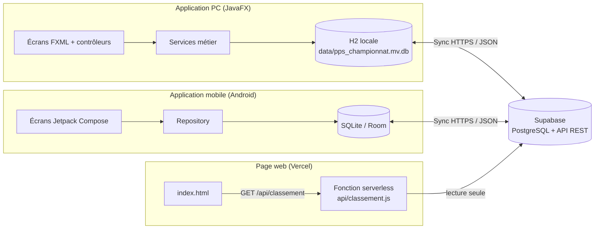

# Document technique (v3)

> Ce document décrit **comment** l'application est conçue et réalisée : architecture, base de données, API, technologies, tests et déploiement. Les besoins et objectifs sont décrits dans le [Cahier des charges v3](https://github.com/PPS-SAE-S5/PPS-COMP-2027/blob/main/Documentation/Sprint%203/CahierDesCharges(FR)v3.md).

>
> **Version 3 (Sprint 3)** : ce document décrit le code de la`Version PC`, de la `Version Mobile` ainsi que la page web (du classement, trouvable dans le dossier `Base-de-donnees`).

## Table des matières

1. [Architecture](#1-architecture)
   - 1.1 [Vue d'ensemble](#11-vue-densemble)
   - 1.2 [Organisation du code](#12-organisation-du-code)
   - 1.3 [Fonctionnement hors-ligne et synchronisation](#13-fonctionnement-hors-ligne-et-synchronisation)
2. [Conception de la base de données](#2-conception-de-la-base-de-données)
   - 2.1 [Base locale (PC et mobile)](#21-base-locale-pc-et-mobile)
   - 2.2 [Colonnes de synchronisation](#23-colonnes-de-synchronisation)
3. [Logique métier](#3-logique-métier)
   - 3.1 [Calcul des points](#31-calcul-des-points)
   - 3.2 [Classements et catégories](#32-classements-et-catégories)
   - 3.3 [Planning et export PDF](#33-planning-et-export-pdf)
   - 3.4 [Rôles et droits d'accès](#34-rôles-et-droits-daccès)
   - 3.5 [Page web de classement](#35-page-web-de-classement)
4. [API](#4-api)
5. [Sécurité](#5-sécurité)
6. [Technologies](#6-technologies)
   - 6.1 [Application PC](#61-application-pc)
   - 6.2 [Application mobile](#62-application-mobile)
   - 6.3 [Base en ligne et page web](#63-base-en-ligne-et-page-web)
7. [Évolution des versions](#7-évolution-des-versions)
8. [Tests](#8-tests)
9. [Déploiement](#9-déploiement)
10. [Limites connues et suite](#10-limites-connues-et-suite)

---

</br>

## 1. Architecture

### 1.1 Vue d'ensemble

L'application suit une approche **"local d'abord" (offline-first)** : chaque ordinateur et chaque téléphone possède sa propre base de données locale et fonctionne sans internet.\
Une base **Supabase** (PostgreSQL) partagée sert de point d'échange : quand une connexion est disponible, les appareils s'y synchronisent.\
La page web lit cette base pour afficher le classement.

</br>


</br>

| Composant | État | Description |
|---|---|---|
| Application PC | Réalisée | Application de bureau JavaFX & base locale H2 |
| Application mobile | Réalisée | Application Android (Kotlin, Jetpack Compose) & base locale SQLite |
| Base en ligne | Réalisée | Supabase (PostgreSQL), accessible par son API REST |
| Page web | Réalisée | Classement en lecture seule hébergé sur Vercel : [pps-classement.vercel.app](https://pps-classement.vercel.app/) |

---


Les deux applications n'ont pas de serveur intermédiaire : elles appellent directement l'API REST de Supabase.\
Seule la page web passe par une fonction serverless, (qui garde la clé Supabase côté serveur pour ne pas l'avoir dans le code source).

</br>

---

### 1.2 Organisation du code

```
PPS-COMP-2027/
├── Documentation/              Documents par sprint & comptes rendus de réunion
|
├── Base-de-donnees/
│   ├── schema.sql                                  Schéma PostgreSQL de la BD
│   ├── index.html                                  Page web du classement
│   └── api/classement.js                           Fonction serverless Vercel 
|
├── Version PC/parapente-pps/                       Branche Dev-ordinateur
│   ├── pom.xml
│   └── src/
│       ├── main/java/com/pps/parapente/            Code Java
│       ├── main/resources/
│       │   ├── com/pps/parapente/view/             Écrans FXML, style, logo
│       │   └── db/schema.sql                       Schéma de la BD locale H2
│       └── test/java/com/pps/parapente/service/    Tests JUnit
|
└── Version Mobile/parapente-pps-android-v0.99/     Branche Dev-mobile
    ├── build.gradle.kts, settings.gradle.kts
    └── app/src/main/java/com/pps/parapente/        Code Kotlin 
```

</br>

**Application PC** : architecture en couches, package `com.pps.parapente` :

| Package | Contenu |
|---|---|
| (racine) | `MainApp` (application JavaFX) et `Launcher` (point d'entrée du JAR exécutable) |
| `model` | Classes métier : `Pilote`, `Epreuve`, `EpreuveParametre`, `BaremePoint`, `Resultat`, `Journee`, `Atelier`, `Utilisateur`, `SuiviParticipant`, `LigneClassement`, et les énumérations `Role`, `ModeCalcul`, `SensClassement`, `Creneau`, `Categorie`, `FiltreGenre`, `FiltreCategorie` |
| `dao` | Accès à la base H2 en JDBC : `DatabaseManager`, `PiloteDAO`, `EpreuveDAO`, `InscriptionDAO`, `ResultatDAO`, `PlanningDAO`, `UtilisateurDAO` |
| `service` | Logique métier : `AuthService`, `PiloteService`, `EpreuveService`, `CalculService`, `ClassementService`, `PlanningService`, `SuiviParticipantService`, `ExportPdfService` |
| `controller` | Un contrôleur JavaFX par écran : connexion, tableau de bord, pilotes, épreuves (liste et formulaire), planning (journées et formulaire d'atelier), saisie, classements, suivi des participants, comptes, synchronisation |
| `sync` | Synchronisation avec Supabase : `SyncService`, `SupabaseClient`, `SyncConfig`, `RapportSync` |
| `util` | `SceneManager` (navigation), `SessionManager` (utilisateur connecté), `SecuriteUtil` (hachage), `MessageErreurUtil` (messages en français), `CategorieConfig` (règle pompier / open), `PdfSimple` (écriture de PDF) |

---

</br>

**Application mobile** : package `com.pps.parapente` :

| Dossier | Contenu |
|---|---|
| (racine) | `MainActivity` |
| `data` | Base Room (`AppDatabase`, `Entities`, `PpsDao`), `Repository` (logique métier : calculs, classements, planning, comptes), `Models`, `Securite`, `MessageErreur`, `Format` |
| `sync` | Synchronisation avec Supabase : `SyncService`, `SupabaseClient`, `SyncConfig`, `RapportSync` (même principe que sur PC) |
| `ui` | `AppNav` (navigation et synchronisation au démarrage), `Composants`, `Theme` |
| `ui/screens` | Un fichier par écran : `LoginScreen`, `DashboardScreen`, `EpreuvesScreens`, `PilotesScreens`, `PlanningScreens`, `SaisieScreen`, `ClassementScreen`, `SuiviScreen`, `UtilisateursScreen`, `SyncScreen` |

---

Les deux applications utilisent la même base Supabase.\
La version mobile n'a pas encore reçu les évolutions de fin de sprint de la version PC (voir [section 10](#10-limites-connues-et-suite)).

---

</br>

### 1.3 Fonctionnement hors-ligne et synchronisation

- Toutes les données sont d'abord écrites en local : l'application reste utilisable sans réseau.
- L'écran **"Synchronisation en ligne"** (administrateur et responsable d'épreuve, sur PC et sur mobile) échange les données avec Supabase.
- Chaque ligne synchronisée porte un identifiant stable (`uuid`) et une date de modification (`updated_at`) (voir [2.3](#23-colonnes-de-synchronisation)).
- **Règle de conflit** : si la même donnée a été modifiée sur deux appareils, la modification la plus récente est conservée.
- **Règles de rapprochement** (pour éviter les doublons) : pilotes par numéro de licence, comptes par identifiant, inscriptions et résultats par couple pilote + épreuve.


</br>

| Mode | Effet |
|---|---|
| **Fusionner** | Échange dans les deux sens, ne supprime jamais rien |
| **Base en ligne → application** ("pull") | L'application devient identique à la base en ligne : ce qui n'existe plus en ligne est supprimé en local |
| **Application → base en ligne** ("push") | La base en ligne devient identique à l'application : ce qui n'existe plus en local est supprimé en ligne |


---


Garde-fous : confirmation avant chaque mode qui supprime, refus d'écraser une base remplie par une base vide, le compte `admin` et le compte connecté ne sont jamais supprimés. La synchronisation automatique au démarrage, facultative, fonctionne en réception seule : elle récupère les nouveautés sans rien envoyer ni supprimer.

</br>

---

## 2. Conception de la base de données

### 2.1 Base locale (PC et mobile)

La base locale (H2 sur PC et SQLite/Room sur mobile) est créée au premier lancement.\
Sur PC, le script `src/main/resources/db/schema.sql` est rejoué à chaque démarrage (`CREATE TABLE IF NOT EXISTS`, `ALTER TABLE ... IF NOT EXISTS`), ce qui met à jour une base existante sans perte de données.

| Table | Contenu | Remarques |
|---|---|---|
| `utilisateurs` | Comptes de connexion : identifiant, mot de passe haché, rôle, actif | Lien facultatif vers un pilote |
| `pilotes` | N° de licence (unique), nom, prénom, département, poids, email, année de naissance, genre, n° de pilote, catégorie | Le champ "caserne" a été renommé `departement`. `numero_pilote` (unique s'il est renseigné) et `categorie` (`POMPIER` ou `OPEN`) existent sur PC uniquement |
| `epreuves` | Épreuve paramétrable : mode de calcul, formule, valeur clé, sens du classement, affichage du classement, comptée au général, active | Voir [3.1](#31-calcul-des-points) |
| `epreuve_parametres` | Variables à saisir pour une épreuve : nom, libellé, unité, obligatoire | Créées librement par le responsable |
| `bareme_points` | Table rang → points | Utilisée en mode `BAREME` |
| `inscriptions_epreuve` | Pilotes inscrits à chaque épreuve | Unique par (pilote, épreuve) |
| `resultats` | Valeurs saisies (JSON), points calculés, disqualification, auteur, date | Unique par (épreuve, pilote) |
| `journees` | Journée de compétition : nom, date, ordre | |
| `ateliers` | Atelier d'une journée : créneau (`MATIN` ou `APRES_MIDI`), heures de début et de fin, lieu, responsable | |
| `atelier_epreuves` | Épreuves d'un atelier avec leur ordre de passage | Une épreuve n'appartient qu'à un seul atelier |

---

</br>

Au premier lancement deux comptes sont créés :\
Le compte administrateur `admin` par défaut et le compte `invité` utilisé par le bouton "Non, je veux uniquement suivre le classement" (voir [3.4](#34-rôles-et-droits-daccès) et [section 5](#5-sécurité)).

Sur PC, le dossier `data/` contient aussi `categories.properties` (règle pompier / open, voir [3.2](#32-classements-et-catégories)) et `sync.properties` (configuration de la synchronisation).

</br>

---

### 2.2 Colonnes de synchronisation

Pour faire correspondre les lignes entre appareils, les tables synchronisées ont reçu :

| Colonne | Rôle |
|---|---|
| `uuid` | Identifiant stable partagé entre tous les appareils (l'`id` local recommence à 1 sur chaque appareil) |
| `updated_at` | Date de dernière modification, pour savoir quelle version est la plus récente |
| `supabase_id` (pilotes et épreuves) | Identifiant attribué par Supabase, nécessaire pour renseigner les clés étrangères lors de l'envoi |

---

</br>

## 3. Logique métier

### 3.1 Calcul des points

Les épreuves sont entièrement paramétrables : le responsable crée ses variables à saisir et choisit un mode de calcul (`CalculService` sur PC, `Repository` sur mobile).

</br>

| Mode | Principe |
|---|---|
| `FORMULE` | Expression mathématique libre évaluée avec **exp4j**, par exemple `100 - temps*2 + nbrBalises*10`. Les variables sont celles de l'épreuve, plus `age` et `poidsPilote` issus de la fiche du pilote |
| `BAREME` | Les pilotes sont classés sur une **valeur clé** (`ASC` : plus petit = meilleur, `DESC` : plus grand = meilleur), puis reçoivent les points du barème selon leur rang. Les points de tous les pilotes de l'épreuve sont recalculés à chaque nouvelle saisie |

---

</br>

Règles du club appliquées :
- un pilote **disqualifié** (sécurité) obtient 0 point et ne prend pas de rang,
- un pilote inscrit à une épreuve sans résultat obtient 0 point,
- un nouveau pilote est inscrit automatiquement à toutes les épreuves actives.

Chaque épreuve possède aussi les options **« afficher le classement »** (US 10) et **« compte dans le classement général »**.

</br>

### 3.2 Classements et catégories

- **Classement général** : une colonne par épreuve comptant au général, et le total.
- **Détail par épreuve** : seules les épreuves dont l'option "afficher le classement" est cochée sont proposées.
- **Filtre par genre** (`FiltreGenre`) : **Général** (hommes et femmes), **Hommes** ou **Femmes**.\
Les rangs sont recalculés parmi les pilotes retenus. Un pilote sans genre renseigné n'apparaît que dans le classement général.
- **Filtre par catégorie** (`FiltreCategorie`, version PC et page web) : **Toutes catégories**, **Pompiers (championnat)** ou **Open (hors championnat)**.

La catégorie d'un pilote est proposée à l'inscription à partir de son numéro de pilote (`CategorieConfig`). La règle est lue dans `data/categories.properties`, créé au premier lancement :

```properties
# Numéros réservés aux participants « open », une plage s'écrit début-fin
numeros.open = 46, 100-199
```

Tous les autres numéros sont des pompiers.\
La catégorie reste modifiable sur la fiche du pilote.\
Une modification du fichier ne change pas les pilotes déjà enregistrés et demande un redémarrage de l'application.

Sur mobile, le filtre par genre s'appelle encore **Mixte (hommes + femmes)** et le filtre par catégorie n'existe pas (car l'application n'est en l'état pas à jour).

</br>

### 3.3 Planning et export PDF

Structure : **journée → ateliers (matin / après-midi) → épreuves**.\
Une épreuve n'appartient qu'à un seul atelier et son ordre de passage dans l'atelier est conservé.

Sur PC, `PlanningService` refuse d'enregistrer un atelier incomplet ([issue #45](https://github.com/PPS-SAE-S5/PPS-COMP-2027/issues/45)).\
Champs obligatoires : nom, journée, créneau, heure de début, heure de fin, lieu, responsable.\
Les heures doivent être au format `HH:mm` et l'heure de fin doit suivre l'heure de début. Sur mobile, seul le nom de l'atelier est encore obligatoire..

L'export PDF d'une journée ([issue #50](https://github.com/PPS-SAE-S5/PPS-COMP-2027/issues/50), PC uniquement) est réalisé par `ExportPdfService`, qui s'appuie sur `PdfSimple`, un générateur de PDF écrit dans le projet (format A4, polices standard, sans bibliothèque externe).\
Le PDF contient le logo, la journée et ses ateliers par créneau avec horaires, lieu, responsable et épreuves. Le bouton "Exporter en PDF" reste disponible pour les rôles qui consultent le planning en lecture seule.

</br>

### 3.4 Rôles et droits d'accès

Les droits sont appliqués côté application : le tableau de bord masque les cartes non autorisées après la connexion (`DashboardController` sur PC, `DashboardScreen` sur mobile).\
Les deux versions appliquent les mêmes règles.

| Rôle | Écrans accessibles |
|---|---|
| `ADMINISTRATEUR` | Tous |
| `RESPONSABLE_EPREUVE` | Tous sauf la gestion des comptes |
| `BENEVOLE` | Planning (lecture seule), pilotes, saisie des résultats, classements, suivi des participants |
| `COMITE_PILOTES` | Planning (lecture seule), classements |
| `PILOTE` | Classements uniquement (accès invité) |

---

</br>

Seuls l'administrateur et le responsable d'épreuve peuvent modifier le planning (`PlanningController` sur PC, `Role.peutModifierPlanning()` sur mobile).

**Accès invité.** Le bouton "Non, je veux uniquement suivre le classement" de l'écran de connexion connecte l'application avec le compte `invité` (rôle `PILOTE`).\
Ce compte arrive directement sur l'écran des classements, et le bouton de retour le déconnecte. 

Sur mobile, le compte est créé à la première utilisation s'il n'existe pas sur l'appareil (`Repository.connexionInvite()`).

</br>

### 3.5 Page web de classement

La page web (`Base-de-donnees/index.html`) affiche le classement en direct, sans compte.\
Elle est hébergée sur Vercel avec la fonction serverless `api/classement.js`.

- La fonction lit les tables Supabase en pages de 1 000 lignes, avec les variables d'environnement Vercel `SUPABASE_URL` et `SUPABASE_KEY`. La clé n'apparaît jamais dans le HTML.
- Les points sont déjà calculés par les applications (`resultats.points`) : la fonction les additionne. Pour chaque épreuve active qui compte au général, un pilote inscrit sans résultat obtient 0 point.
- Le navigateur calcule les rangs et applique les filtres : classement général ou détail par épreuve, Général / Hommes / Femmes, Toutes catégories / Pompiers / Open.
- La page se rafraîchit toutes les 60 secondes quand l'onglet est visible (US 07). Un bouton met ce rafraîchissement en pause et un autre change le thème clair / sombre.

---

</br>

## 4. API

- **Format d'échange** : JSON.
- **API des applications** : l'API REST est générée par Supabase (PostgREST) à partir du schéma PostgreSQL.\
Les applications appellent `https://<projet>.supabase.co/rest/v1/<table>` en HTTPS avec la clé publique dans l'en-tête `apikey`.\
Le client est écrit dans le projet (`SupabaseClient`, client HTTP natif de Java sur PC, équivalent Kotlin sur mobile).

---

</br>

| Opération | Requête | Usage |
|---|---|---|
| Lecture | `GET /rest/v1/{table}?select=...` | Récupération des données, test de connexion |
| Insertion / mise à jour (upsert) | `POST /rest/v1/{table}?on_conflict={colonne}` avec `Prefer: resolution=merge-duplicates` | Envoi des données (conflit sur `numero_licence`, `uuid`, `identifiant`...) |
| Insertion simple | `POST /rest/v1/{table}` | Ajout de lignes |
| Suppression | `DELETE /rest/v1/{table}?{filtre}` (ex. `id=eq.12`) | Synchronisation "miroir" |

---

- **API de la page web** : `GET /api/classement` (fonction Vercel) renvoie en JSON les pilotes, leurs points par épreuve et le détail des épreuves affichables.

L'URL du projet Supabase et la clé sont saisies dans l'écran de synchronisation.\
Sur PC, elles sont enregistrées dans `data/sync.properties`.
Sur mobile elles sont dans les préférences de l'application.

---

</br>

## 5. Sécurité

Points en place :
- Mots de passe hachés en SHA-256 avant stockage et avant envoi à Supabase.
- RLS activée sur les tables Supabase du script `schema.sql`.
- Comptes désactivables sans perte d'historique, identifiants uniques sans tenir compte des majuscules, le compte `admin` ne peut être ni supprimé ni désactivé.
- La clé de la page web reste côté serveur (variables d'environnement Vercel).

Limites connues :
- **Comptes par défaut** : le mot de passe du compte `admin` (`admin123`) doit être changé avant tout usage réel.
- **SHA-256 sans sel** : insuffisant pour des données exposées. Un hachage avec sel (bcrypt, argon2) ou Supabase Auth est à prévoir.
- Les droits par rôle ne sont appliqués que dans les applications, pas sur le serveur. Une protection réelle demande des politiques RLS par rôle ou un serveur intermédiaire.
- Exigences de sécurité et de RGPD (poids, année de naissance, email des pilotes) à préciser avec le client.

---

</br>

## 6. Technologies

### 6.1 Application PC

| Élément | Choix |
|---|---|
| Langage | Java 17 |
| Interface | JavaFX 21.0.2 (FXML + CSS) |
| Build | Maven : `javafx-maven-plugin` pour le lancement, `maven-shade-plugin` pour le JAR exécutable (classe d'entrée `Launcher`) |
| Base locale | H2 2.2.224 (fichier dans `data/`) |
| Calcul de formules | exp4j 0.4.8 |
| JSON | `org.json` |
| PDF | `PdfSimple` écrit dans le projet |
| Tests | JUnit 5.10.2, Mockito 5.18.0 |

</br>

### 6.2 Application mobile

| Élément | Choix |
|---|---|
| Langage | Kotlin (JVM 17) |
| Interface | Jetpack Compose (Material 3, BOM 2024.06.00) |
| Build | Gradle (Kotlin DSL), Android 8.0 (API 26) minimum, cible API 34 |
| Base locale | Room 2.6.1 (SQLite) avec KSP |
| Calcul de formules | exp4j 0.4.8 |
| Asynchrone | Kotlin Coroutines 1.8.1 |

</br>

### 6.3 Base en ligne et page web

- **Supabase** : base PostgreSQL, API REST générée, RLS.\
L'authentification et le temps réel de Supabase ne sont pas utilisés : les comptes sont gérés par les applications (table `utilisateurs`) et les données circulent par la synchronisation.
- **Page web** : HTML, CSS et JavaScript sans framework avec fonction serverless Node.js sur Vercel.

---

</br>

## 7. Évolution des versions

| Sujet | Prévu en v1 | Réalisé (v3) |
|---|---|---|
| Interface | React / Node.js et Tailwind CSS, ou Java / JavaFX | JavaFX (PC), Kotlin / Jetpack Compose (mobile), HTML / JavaScript (page web) |
| Architecture | Interface + Supabase | Applications locales synchronisées avec Supabase (offline-first) |
| Base de données | PostgreSQL via Supabase uniquement | H2 (PC) et SQLite/Room (mobile) en local, PostgreSQL en ligne |
| Authentification | Supabase Auth (envisagée) | Comptes gérés par l'application (SHA-256) |
| Temps réel | Supabase Realtime (envisagé) | Synchronisation à la demande ou au démarrage & page web rafraîchie toutes les 60 s |
| Calcul des points | Non défini | Formule libre (exp4j) ou barème par rang |
| Déploiement | Vercel | JAR (PC) et APK (mobile) publiés en release GitHub & Vercel pour la page web |

---

</br>

Ajouts du Sprint 3 :
- planning des journées (PC et mobile)
- suivi des participants avec recherche (PC et mobile)
- accès invité au classement depuis l'écran de connexion (PC et mobile)
- page web de classement sur Vercel
- catégories pompier / open et filtre « Général » (PC et page web)
- champs obligatoires d'un atelier et export PDF d'une journée (PC)
- logo définitif (PC)
- migrations Room sans perte de données (mobile)
- tests unitaires JUnit (PC)

---

</br>

## 8. Tests

### 8.1 Stratégie de test

- Tests unitaires JUnit sur la logique métier de la version PC (couche `service`).
- Tests manuels des cas d'utilisation sur toutes les plateformes, y compris en mode hors-ligne puis après synchronisation.
- À venir : tests de la synchronisation sous contrainte (modifications concurrentes sur deux appareils, coupures réseau, base vide ou très remplie).


</br>

### 8.2 État des tests (en l'état)

| Type de test | État |
|---|---|
| Tests unitaires JUnit (PC) | 140 tests dans 8 classes : `PlanningServiceTest` (36), `SuiviParticipantServiceTest` (24), `EpreuveServiceTest` (18), `PiloteServiceTest` (18), `ExportPdfServiceTest` (18), `ClassementServiceTest` (12), `CalculServiceTest` (9), `AuthServiceTest` (5). Lancement : `mvn test` |
| Tests unitaires (mobile) | À faire : aucun test dans le dépôt |
| Tests de synchronisation (conflits, hors-ligne) | À faire |
| Tests manuels des cas d'utilisation (CU 01 à CU 12) | Réalisés lors des démonstrations de fin de sprint |

---

</br>

## 9. Déploiement

Les fichiers à installer sont publiés dans les [releases GitHub](https://github.com/PPS-SAE-S5/PPS-COMP-2027/releases).\
La release 2.1 contient `PPS-COMP.v2.1-SNAPSHOT.jar` (PC) et `PPS-COMP-2.1.apk` (mobile).

| Composant | Livraison | Détail |
|---|---|---|
| Application PC | Fichier `.jar` exécutable, généré par `mvn clean package` | Java 17 ou plus récent, testée sous Windows et macOS. La base locale est le dossier `data/` créé à côté du point de lancement (à sauvegarder). |
| Application mobile | Fichier `.apk` | Android 8.0 minimum. Android affiche un avertissement Play Protect, c'est normal car l'application n'est pas publiée sur le Play Store |
| Base en ligne | Supabase | Scripts SQL à exécuter une fois dans l'éditeur SQL de Supabase |
| Page web | Vercel | Déploiement du dossier `Base-de-donnees` (`index.html` + `api/`) + variables d'environnement `SUPABASE_URL` et `SUPABASE_KEY` |

---

</br>

Il n'y a pas de déploiement continu : les releases sont préparées à la fin de chaque sprint.

---

</br>

## 10. Limites connues et suite

- **Historique des modifications de points** ([US 13](https://github.com/PPS-SAE-S5/PPS-COMP-2027/issues/21), issues [#21](https://github.com/PPS-SAE-S5/PPS-COMP-2027/issues/21) et [#39](https://github.com/PPS-SAE-S5/PPS-COMP-2027/issues/39)) : non réalisé.
- **Alignement de la version mobile** sur la branche PC : catégories pompier / open et numéro de pilote, filtre "Général", champs obligatoires d'un atelier, export PDF, logo définitif (le logo du mobile est encore le logo provisoire).
- **Numéros de version** : le dossier mobile s'appelle `parapente-pps-android-v0.99`, `build.gradle.kts` indique `versionName = "2.0"` et `pom.xml` indique `2.0-SNAPSHOT`, alors que la release publiée est la [2.1](https://github.com/PPS-SAE-S5/PPS-COMP-2027/releases/tag/v2.1).\
Les trois sont à harmoniser d'ici la fin du sprint 3.
- **Scripts de la base en ligne** à regrouper et à mettre à jour, ainsi que [`BaseDeDonnées.md`](https://github.com/PPS-SAE-S5/PPS-COMP-2027/blob/main/Base-de-donnees/BaseDeDonn%C3%A9es.md).
- **Sécurité** : hachage, droits côté serveur (RLS par rôle), retrait de `sync.properties` et de la base locale du dépôt.
- **Tests** : tests de la version mobile, tests de synchronisation et plan de tests formalisé.
- **Demandes du client** ([réunion 4bis](https://github.com/PPS-SAE-S5/PPS-COMP-2027/blob/main/Documentation/R%C3%A9unions/Compte%20rendu%20de%20r%C3%A9union%204bis.md)) : import des pilotes depuis Excel ([#48](https://github.com/PPS-SAE-S5/PPS-COMP-2027/issues/48)), export des classements en Excel ([#49](https://github.com/PPS-SAE-S5/PPS-COMP-2027/issues/49)), limites des ateliers dans un fichier de configuration ([#51](https://github.com/PPS-SAE-S5/PPS-COMP-2027/issues/51)), sponsors sur la page de connexion ([#53](https://github.com/PPS-SAE-S5/PPS-COMP-2027/issues/53)).
