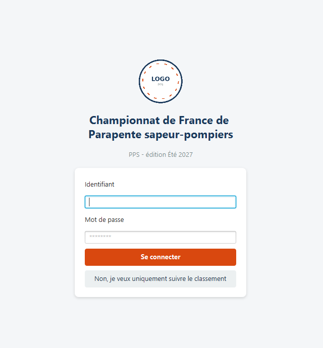
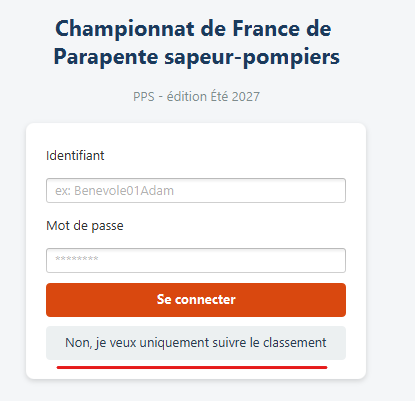
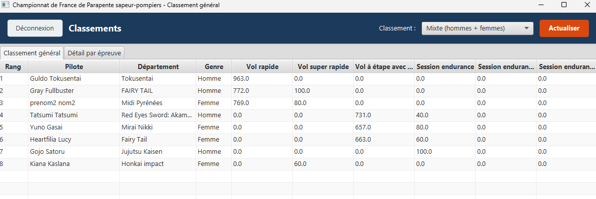
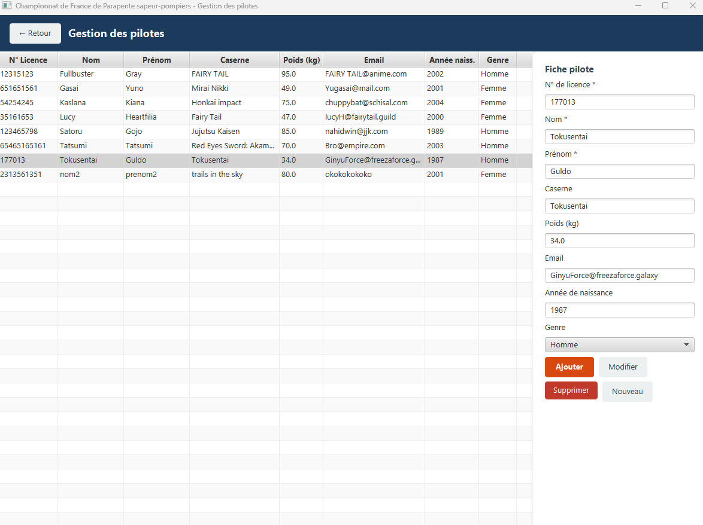
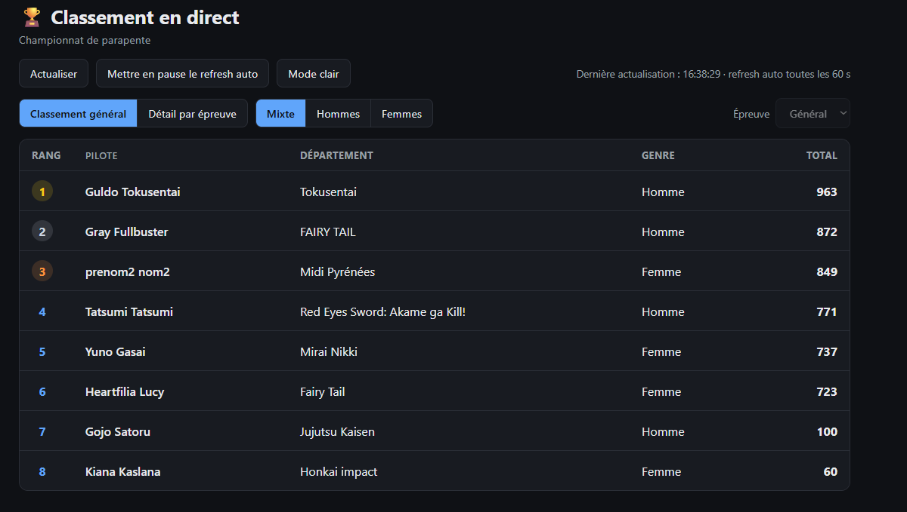

# Documentation utilisateur (fr) v3 - version PC

## Sommaire

- [1. Présentation générale](#1-présentation-générale)
- [2. Installation](#2-installation)
- [3. Connexion et rôles](#3-connexion-et-rôles)
- [4. Tableau de bord](#4-tableau-de-bord)
- [5. Gestion des pilotes](#5-gestion-des-pilotes)
- [6. Gestion des épreuves](#6-gestion-des-épreuves)
- [7. Planning des journées](#7-planning-des-journées)
- [8. Saisie des résultats](#8-saisie-des-résultats)
- [9. Classements](#9-classements)
- [10. Suivi des participants](#10-suivi-des-participants)
- [11. Gestion des comptes (administrateur)](#11-gestion-des-comptes-administrateur)
- [12. Synchronisation en ligne](#12-synchronisation-en-ligne)
- [13. Stockage des données et sauvegarde](#13-stockage-des-données-et-sauvegarde)
- [14. Classement sur internet](#14-classement-sur-internet)
- [15. Questions fréquentes](#15-questions-fréquentes)

---

## 1. Présentation générale

L'application remplace les feuilles papier et les fichiers Excel utilisés jusqu'ici pour organiser le championnat. Elle permet :

- d'inscrire les pilotes, pompiers du championnat ou participants « open » ;
- de créer librement les épreuves : le club choisit leur nombre, leur nom et la façon dont les points sont calculés ;
- d'organiser la compétition en **journées**, **ateliers** et **épreuves**, et d'exporter le planning d'une journée en PDF ;
- de saisir les résultats au fil des épreuves ;
- de consulter le **classement provisoire**, général ou par épreuve, avec des filtres hommes / femmes et pompiers / open ;
- de suivre le détail des scores de chaque pilote ;
- de **synchroniser** les données entre plusieurs ordinateurs et téléphones dès qu'internet est disponible.

L'application fonctionne **sans internet** : les données sont enregistrées sur l'ordinateur, puis partagées en ligne quand une connexion est disponible (voir [section 12](#12-synchronisation-en-ligne)).

> Une version **mobile (Android)** existe également. Voir la documentation utilisateur de la version mobile.

---

## 2. Installation

1. Ouvrez la page des [releases du projet](https://github.com/PPS-SAE-S5/PPS-COMP-2027/releases) et téléchargez le fichier `.jar` de la dernière version (par exemple `PPS-COMP.v2.1-SNAPSHOT.jar`).
2. Placez le fichier dans un dossier dédié, par exemple `PPS Championnat` : l'application y créera son dossier de données `data/`.
3. Lancez l'application par un double-clic sur le fichier. Si rien ne se passe, ouvrez un terminal dans ce dossier et tapez `java -jar` suivi du nom du fichier.

L'application fonctionne sous Windows et sous macOS. Elle nécessite **Java 17 ou plus récent** installé sur l'ordinateur.

---

## 3. Connexion et rôles

Au démarrage, l'application affiche l'écran de connexion. Saisissez votre **identifiant** et votre **mot de passe**, puis cliquez sur **Se connecter**.



Chaque compte a un **rôle**, qui détermine ce qu'il peut faire :

| Rôle | Peut faire |
|---|---|
| **Administrateur** | Tout, y compris créer les comptes des autres utilisateurs |
| **Responsable de l'épreuve** | Gérer les épreuves, le planning et les pilotes, saisir les résultats, suivre les participants, consulter les classements, synchroniser |
| **Bénévole** | Gérer les pilotes, saisir les résultats, suivre les participants, consulter les classements et le planning |
| **Comité des pilotes** | Consulter le planning et les classements |

Un compte administrateur existe par défaut après l'installation. **Créez vos propres comptes, puis changez le mot de passe du compte par défaut** (voir [section 11](#11-gestion-des-comptes-administrateur)).

### Suivre le classement sans compte

Une personne qui veut seulement voir le classement (pilote, public, famille...) n'a pas besoin de compte : elle clique sur **Non, je veux uniquement suivre le classement**.



L'application ouvre directement l'écran des classements, en lecture seule. Le bouton **Déconnexion** ramène à l'écran de connexion.



Le classement est aussi consultable sur internet (voir [section 14](#14-classement-sur-internet)).

---

## 4. Tableau de bord

Après la connexion, le tableau de bord affiche, sous forme de cartes cliquables, uniquement les fonctions auxquelles votre rôle donne accès. Les cartes sont rangées en trois sections :

| Section | Cartes |
|---|---|
| **Préparer la compétition** | Gestion des épreuves, Planning des journées, Gestion des pilotes |
| **Pendant la compétition** | Saisie des résultats, Classement général, Suivi des participants |
| **Administration** | Gestion des comptes, Synchronisation en ligne |

Votre identifiant et votre rôle s'affichent en haut de l'écran, à côté du bouton **Déconnexion**.


---

## 5. Gestion des pilotes

Cet écran sert à inscrire les pilotes au championnat.



**Informations de la fiche pilote :**

- N° de pilote (attribué par l'organisation, facultatif, unique)
- Catégorie : **Pompier** (participe au championnat) ou **Open** (invité, classé hors championnat)
- N° de licence (obligatoire, unique)
- Nom et prénom (obligatoires)
- Département
- Poids (kg)
- Email
- Année de naissance
- Genre (Homme ou Femme)

**Utilisation :**

1. Remplissez la fiche à droite et cliquez sur **Ajouter**.
2. Pour modifier un pilote, cliquez sur sa ligne dans le tableau : la fiche se remplit. Modifiez les champs, puis cliquez sur **Modifier**.
3. Pour supprimer un pilote, sélectionnez-le et cliquez sur **Supprimer**. Ses résultats déjà saisis sont supprimés aussi.
4. Cliquez sur **Nouveau** pour vider la fiche.

> Quand vous saisissez le numéro de pilote, l'application propose la catégorie correspondante. Les numéros réservés aux participants open sont définis par l'organisation dans le fichier `data/categories.properties` (voir [section 13](#13-stockage-des-données-et-sauvegarde)). Vous pouvez toujours changer la catégorie à la main.

> Un nouveau pilote est inscrit automatiquement à toutes les épreuves actives. S'il ne se présente pas à une épreuve, il y obtient 0 point.

> Le **genre** sert aux classements hommes / femmes ([section 9](#9-classements)). Un pilote sans genre renseigné n'apparaît que dans le classement général.

---

## 6. Gestion des épreuves

Aucune épreuve n'est prédéfinie. Le club crée chaque épreuve du championnat (atterrissage de précision, marche & vol, cross, checkpoint ou toute autre épreuve) avec ses propres règles de calcul des points.


Le tableau liste les épreuves avec leur mode de calcul, leur règle et trois indicateurs : **Classement visible**, **Compte au général** et **Active**.

Sous le tableau :
- **+ Nouvelle épreuve** ouvre le formulaire de création ;
- **Modifier l'épreuve sélectionnée** ;
- **Dupliquer l'épreuve sélectionnée** crée une copie, pratique pour une épreuve proche d'une autre ;
- **Supprimer** efface l'épreuve et ses résultats.


</br>

</br>


### 6.1 Informations générales

Renseignez le **nom** et la **description** de l'épreuve.

### 6.2 Variables à saisir

Définissez les valeurs qui seront mesurées pendant l'épreuve (par exemple `temps`, `nbrBalises`, `poidsSac`, `distance`). Chaque variable a :
- un **nom technique**, sans espace, utilisé dans le calcul ;
- un **libellé**, affiché lors de la saisie ;
- une **unité**, facultative.

Utilisez **+ Ajouter une variable** et **Retirer la variable sélectionnée**.

### 6.3 Mode de calcul des points

Deux modes au choix.

**a) Formule mathématique**


Écrivez une formule avec les variables définies plus haut, par exemple :

```
100 - temps*2 + nbrBalises*10 - poidsSac*0.5
```

Deux variables issues de la fiche du pilote sont disponibles sans saisie : `age` et `poidsPilote`.

**b) Barème par classement**


Les pilotes sont classés selon une variable de votre choix (par exemple `temps` ou `distance`), dans le sens que vous indiquez : la plus petite valeur gagne, ou la plus grande. Ils reçoivent ensuite les points d'un tableau « rang → points » que vous définissez (par exemple 1er = 100 pts, 2e = 90 pts, 3e = 80 pts). Au-delà du dernier rang défini, les points du dernier rang s'appliquent à tous les suivants.

> Les rangs dépendent de tous les pilotes : le barème est recalculé pour toute l'épreuve à chaque nouvelle saisie.

### 6.4 Options de l'épreuve

- **Afficher le classement** : le détail de l'épreuve est consultable et sa colonne apparaît dans le classement général. Décochée, l'épreuve n'est pas détaillée.
- **Compte dans le classement général** : les points de l'épreuve s'ajoutent au total du championnat.
- **Active** : l'épreuve est proposée dans l'écran de saisie des résultats et dans le planning.

Terminez avec **Enregistrer l'épreuve**.

---

## 7. Planning des journées

Cet écran organise la compétition dans le temps :

**Journée → ateliers (matin / après-midi) → épreuves**


- **+ Nouvelle journée** crée une journée (nom et date). Les flèches `‹` et `›` passent d'une journée à l'autre. **Renommer / changer la date** et **Supprimer la journée** agissent sur la journée affichée.
- **+ Nouvel atelier** ouvre le formulaire d'un atelier.
- **Exporter en PDF** enregistre le planning de la journée affichée dans un fichier PDF, pour l'imprimer ou le diffuser.
- La zone **Épreuves à placer** liste les épreuves actives qui ne sont dans aucun atelier.

### Créer un atelier


Un atelier regroupe plusieurs épreuves sur un créneau d'une journée. Tous les champs suivants sont obligatoires :

- le **nom** de l'atelier et la **journée** ;
- le **créneau** : Matin ou Après-midi ;
- les heures de **début** et de **fin**, au format `HH:mm` (l'heure de fin doit suivre l'heure de début) ;
- le **lieu** et le **responsable**.

Ajoutez ensuite les **épreuves de l'atelier** avec **Ajouter une épreuve...**. L'ordre de la liste est l'ordre de passage : **▲ Monter** et **▼ Descendre** le modifient, **Retirer** enlève l'épreuve de l'atelier.

Si un champ manque, l'atelier n'est pas enregistré et un message indique les champs à compléter.

> Une épreuve ne peut appartenir qu'à **un seul** atelier.

**Droits :** seuls l'administrateur et le responsable de l'épreuve modifient le planning. Le bénévole et le comité des pilotes le consultent et peuvent l'exporter en PDF.

---

## 8. Saisie des résultats


1. Choisissez l'**épreuve** dans la liste déroulante.
2. Choisissez le **pilote** : seuls les pilotes inscrits à cette épreuve apparaissent.
3. Le formulaire affiche un champ pour chaque variable de l'épreuve (voir [section 6.2](#62-variables-à-saisir)).
4. Renseignez les valeurs mesurées. La touche **Entrée** passe au champ suivant ; sur le dernier champ, elle valide la saisie.
5. Si le pilote doit être disqualifié (problème de sécurité...), cochez la case **Disqualifié** : il obtient 0 point.
6. Cliquez sur **Enregistrer le résultat**.


Le tableau de droite liste les résultats déjà saisis pour l'épreuve, avec les points calculés.

Pour corriger un résultat (litige, pénalité), choisissez à nouveau l'épreuve et le pilote, puis enregistrez les nouvelles valeurs : elles remplacent les anciennes.

---

## 9. Classements

L'écran **Classements** propose deux onglets, deux filtres et un bouton **Actualiser** qui recalcule le classement après de nouvelles saisies.

Les filtres s'appliquent aux deux onglets :

| Filtre | Choix |
|---|---|
| **Classement** | **Général (hommes + femmes)**, **Hommes** ou **Femmes** |
| **Catégorie** | **Toutes catégories**, **Pompiers (championnat)** ou **Open (hors championnat)** |

Les rangs sont recalculés parmi les pilotes retenus : la première femme du classement « Femmes » a le rang 1.

### 9.1 Classement général


Pour chaque pilote : rang, département, genre, points sur chaque épreuve qui compte au général, et total.

> Un pilote inscrit à une épreuve mais sans résultat saisi obtient 0 point à cette épreuve : toute personne inscrite doit passer les épreuves.

> Si la case « Afficher le classement » d'une épreuve est décochée, son détail est masqué, mais ses points comptent toujours dans le total si « Compte dans le classement général » est cochée.

### 9.2 Détail par épreuve


Cet onglet affiche le classement d'**une seule épreuve**, avec les valeurs saisies pour chaque pilote. Seules les épreuves dont l'option « Afficher le classement » est cochée sont proposées.

Les classements sont accessibles à tous les rôles et sans compte.

---

## 10. Suivi des participants

Cet écran affiche le détail des scores d'un pilote.


1. Cherchez un pilote dans la barre **Rechercher un pilote** (nom, prénom, licence ou département).
2. Cliquez sur son nom dans la liste de gauche.
3. L'écran affiche son **total de points**, son **rang au classement général** et le nombre d'**épreuves saisies**, puis le tableau **Scores par épreuve** : valeurs saisies, points, statut, et si l'épreuve compte au général.
4. Cliquez sur **Actualiser** pour recharger les données.

> Un pilote inscrit sans résultat compte 0 point pour l'épreuve.

Cet écran est accessible à l'administrateur, au responsable de l'épreuve et au bénévole.

---

## 11. Gestion des comptes (administrateur)


Cet écran, réservé à l'administrateur, gère les comptes des personnes qui organisent la compétition (responsables d'épreuve, bénévoles, comité).

**Créer un compte :** saisissez l'**identifiant**, le **mot de passe** et le **rôle**, puis cliquez sur **Créer le compte**. Les identifiants sont uniques, sans tenir compte des majuscules.

> Le rôle « Pilote » de la liste correspond à l'accès en lecture seule au classement. Il est inutile de créer des comptes pour les pilotes : ils utilisent le bouton « Non, je veux uniquement suivre le classement ».

**Gérer un compte existant :** sélectionnez-le dans le tableau, puis :
- **Activer / Désactiver le compte** : un compte désactivé ne peut plus se connecter, et son historique est conservé ;
- **Changer le mot de passe** : saisissez le nouveau mot de passe, puis validez ;
- **Supprimer le compte sélectionné** : une confirmation est demandée.

> Le compte `admin` par défaut ne peut être ni supprimé ni désactivé. Vous ne pouvez pas non plus supprimer ou désactiver le compte avec lequel vous êtes connecté.
> **Changez le mot de passe du compte `admin` dès la première utilisation.**

---

## 12. Synchronisation en ligne

Les données sont enregistrées sur l'ordinateur. Quand internet est disponible, cet écran envoie ou reçoit les données de la base en ligne (Supabase), partagée entre tous les ordinateurs et téléphones du championnat.

Cet écran est réservé à l'administrateur et au responsable de l'épreuve.


### 12.1 Première configuration

1. Collez l'**URL du projet** et la **clé API publique**, fournies par la personne en charge technique.
2. Cliquez sur **Enregistrer la configuration**, puis sur **Tester la connexion**.
3. (Facultatif) Cochez la **récupération automatique au démarrage** : à chaque lancement, l'application récupère les nouveautés en ligne. Elle ne fait que recevoir : rien n'est envoyé ni supprimé, et le lancement n'est pas bloqué si vous êtes hors-ligne.

### 12.2 Choisir le sens de la synchronisation

| Bouton | Effet |
|---|---|
| **↓ Base en ligne → application** | L'application devient **identique** à la base en ligne. Ce qui a été supprimé en ligne, comptes compris, est supprimé sur l'ordinateur |
| **↑ Application → base en ligne** | La base en ligne devient **identique** à l'application. Ce que vous avez supprimé ici est supprimé en ligne |
| **Fusionner les deux bases** | Échange dans les deux sens, **sans rien supprimer** |

Un résumé indique ensuite le nombre de lignes reçues, envoyées ou supprimées.

> Les deux boutons à sens unique **suppriment** des données et demandent une confirmation. Le compte `admin` et le compte connecté ne sont jamais supprimés. Une base vide ne peut pas écraser une base remplie.

> **Pour supprimer une donnée partout** : supprimez-la sur un appareil et utilisez « Application → base en ligne » sur cet appareil. Sur les autres appareils, utilisez ensuite « Base en ligne → application ».

> Si la même donnée a été modifiée sur deux appareils, la modification la plus récente est conservée. Les pilotes sont reconnus par leur numéro de licence, les comptes par leur identifiant, les inscriptions et les résultats par le couple pilote + épreuve : il n'y a pas de doublons.

---

## 13. Stockage des données et sauvegarde

Toutes les données (pilotes, épreuves, planning, résultats, comptes) sont stockées sur l'ordinateur, dans le dossier `data/` situé à côté de l'application. L'application n'a pas besoin d'internet pour fonctionner ; la synchronisation ([section 12](#12-synchronisation-en-ligne)) sert à partager les données.

**Sauvegardez régulièrement le dossier `data/`** (copie sur clé USB ou disque externe), en particulier avant et pendant le championnat.

Le dossier `data/` contient aussi deux fichiers de réglages :
- `categories.properties` : numéros de pilote réservés aux participants open. Exemple : `numeros.open = 46, 100-199` (une plage s'écrit début-fin). Redémarrez l'application après une modification ; les pilotes déjà inscrits ne changent pas de catégorie ;
- `sync.properties` : configuration de la synchronisation. **Ne le partagez pas publiquement.**

---

## 14. Classement sur internet

Le classement est publié en lecture seule sur la page [pps-classement.vercel.app](https://pps-classement.vercel.app/), accessible depuis n'importe quel navigateur, sans compte.



- Onglets **Classement général** et **Détail par épreuve**.
- Filtres **Général / Hommes / Femmes** et **Toutes catégories / Pompiers / Open**.
- La page se met à jour toutes les 60 secondes. Le bouton **Mettre en pause le refresh auto** arrête cette mise à jour, **Actualiser** la lance à la demande.
- Un bouton passe la page en mode clair ou sombre.

La page affiche les données de la base en ligne : un résultat saisi sur un ordinateur n'y apparaît qu'après une synchronisation vers la base en ligne.

---

## 15. Questions fréquentes

**Un pilote n'apparaît pas dans la liste au moment de la saisie des résultats.**
Vérifiez que l'épreuve est cochée « Active ». Un pilote est inscrit automatiquement aux épreuves actives au moment de son ajout.

**Le classement d'une épreuve n'apparaît pas dans l'onglet « Détail par épreuve ».**
Vérifiez que l'option **« Afficher le classement »** est cochée pour cette épreuve.

**Un pilote n'apparaît pas dans le classement « Hommes » ou « Femmes ».**
Vérifiez que son **genre** est renseigné sur sa fiche. Sans genre, il n'apparaît que dans le classement général.

**Un pilote est classé en « Open » alors qu'il est pompier (ou l'inverse).**
Corrigez la catégorie sur sa fiche. Si l'erreur vient de son numéro de pilote, demandez à l'organisation de vérifier le fichier `categories.properties`.

**L'atelier ne s'enregistre pas.**
Tous les champs de l'atelier sont obligatoires (créneau, horaires, lieu, responsable...). Le message affiché liste ceux qui manquent.

**Une épreuve n'apparaît pas dans le planning.**
Elle est sans doute dans la zone **Épreuves à placer** : ouvrez ou créez un atelier pour l'y ajouter. Seules les épreuves actives sont proposées.

**J'ai modifié le nom d'une épreuve, dois-je ressaisir les résultats ?**
Non. Les résultats sont conservés, seul le nom affiché change.

**Une donnée que j'ai supprimée réapparaît après une synchronisation.**
Le bouton « Fusionner » et la récupération automatique au démarrage ne suppriment jamais rien : la donnée existait encore en ligne ou sur un autre appareil. Voir [section 12.2](#122-choisir-le-sens-de-la-synchronisation).

**Un résultat saisi n'apparaît pas sur la page internet du classement.**
Synchronisez l'ordinateur vers la base en ligne (« Application → base en ligne » ou « Fusionner »), puis attendez la prochaine mise à jour de la page.

**La synchronisation affiche une erreur.**
Vérifiez la connexion internet, l'URL du projet et la clé API, puis cliquez sur **Tester la connexion**. Le message indique la cause : pas de connexion, URL invalide, délai dépassé ou erreur renvoyée par la base en ligne.

**Un message d'erreur apparaît, que faire ?**
Les messages sont rédigés en français simple. Si l'erreur persiste, contactez la personne en charge technique de l'application.
